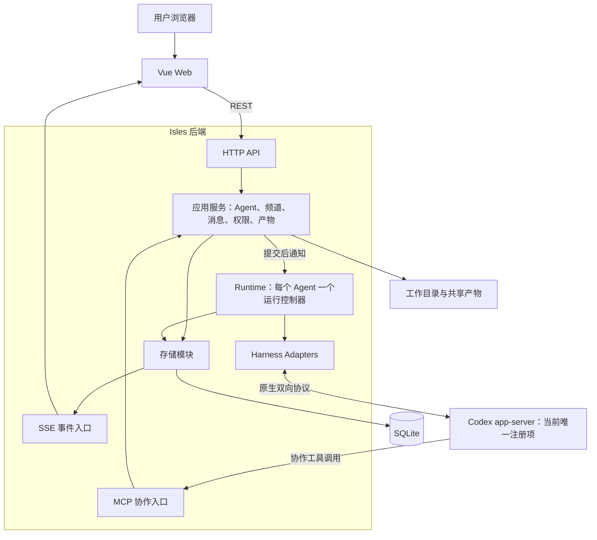

# Isles（群岛）架构设计

> 版本：0.19 · 日期：2026-10-08 · 状态：Codex、Claude CLI 与通用 ACP adapter（Kimi Code）已接入；按能力配置 steer，Kimi 设计见 [Kimi Code ACP 验收](kimi-acp-acceptance.md)
>
> 产品语义以 [需求文档](requirements.md) 为准。本文整理技术选型、模块边界和关键运行流程；已实现范围与阶段验收见 [实现计划](implementation-plan.md)。
>
> “已确认”指用户已明确选择的内容；“建议”指本文提出的实现方案；“待确认”指需要产品决策或接入验证的事项。接口、表名、状态名及目录均为设计示意，尚未冻结。

> 基础规则由工作目录文件加载；自动输入与 MCP 读取共用 [文本消息协议](message-protocol.md)。修复范围及真实加载、压缩、恢复的证据见 [基础修复计划](foundation-repair-plan.md)。

## 1. 架构目标与约束

Isles 是一个让人类与独立 Agent 通过私聊、群聊协作的应用。平台承担通信、权限、持久化和运行管理，各 harness 承担模型调用、工具执行及原生上下文管理。

以下约束已确定：

1. 首版为单用户、单机 Web 应用，Web 服务与所有 harness 在同一台电脑或服务器上运行。
2. 每个 Agent 对应一个 harness、模型与实例，固定绑定一个原生 session。创建尚未完成时可以没有 session；创建成功后始终恢复该绑定。
3. 私聊、群聊和不同工作内容共享该 Agent 的原生 session。需要并行上下文时，由用户创建新的编号 Agent。
4. 只有用户能够创建 Agent。自然语言指定的 leader 身份不自动授予平台权限。
5. 拉群、私聊按 Agent 授权；未获授权的 Agent 看不到相应 MCP 工具，服务端同时校验调用。
6. 每个 Agent 具有独立工作目录和原生 session，不共享对话上下文；harness 的配置、登录、插件与长期记忆可以共用。Agent 间通过消息与显式共享的产物协作。
7. 消息历史由 Isles 保存；上下文压缩和原生 memory 由 harness 管理。
8. 协作分工和 review 可通过自然语言约定，平台不预设固定角色或统一任务流水线。

实现需要保持三种身份的区别：**Agent 是持续存在的参与者，session 是其原生上下文，进程是可以重启的运行载体。** 重启进程不意味着创建新 Agent 或新 session。

## 2. 技术选型

### 2.1 已确认的选择

| 部分         | 选择                                                | 责任                                                                                                 |
| ------------ | --------------------------------------------------- | ---------------------------------------------------------------------------------------------------- |
| 前端框架     | Vue 3                                               | 聊天、Agent 管理和运行状态界面。                                                                     |
| 组件         | shadcn-vue                                          | 基础组件源码纳入项目，按产品交互调整。                                                               |
| 样式         | Tailwind CSS                                        | 布局、主题和组件样式。                                                                               |
| 数据访问     | Drizzle ORM                                         | TypeScript 表结构、查询与事务；配套 Drizzle Kit 管理 schema 基线。                                   |
| 当前 harness | Codex app-server、Claude Code CLI、Kimi Code（ACP） | 通过独立 adapter 保持固定 session 与 MCP 协作；Codex 与 Claude 支持默认关闭的 steer，Kimi 忙碌排队。 |

### 2.2 已确认的实施基线

用户已认可架构并授权按此初始化。依赖版本在各工作区清单和锁文件中固定；具体业务行为仍按文中待确认事项讨论。

| 部分           | 选择                      | 理由与边界                                                                                          |
| -------------- | ------------------------- | --------------------------------------------------------------------------------------------------- |
| 语言与共享协议 | TypeScript 严格模式 + Zod | 前后端共享业务协议类型，并校验运行时输入；当前 TypeScript 固定在兼容 Vue/ESLint 工具链的 6.0 系列。 |
| 前端构建       | Vue 3 + Vite              | 对应所选组件生态，提供独立 Web 客户端。                                                             |
| 前端服务端状态 | TanStack Vue Query        | 管理历史分页、配置查询和事件到达后的缓存更新；本地交互状态另行管理。                                |
| 后端           | Node.js LTS + Fastify     | 持续运行的服务，承载 HTTP、事件推送和 MCP 入口。                                                    |
| 工程组织       | pnpm workspace            | 一个仓库管理前端、后端和共享协议。                                                                  |
| 数据库         | SQLite，启用 WAL          | 适合单机部署；通过 Drizzle 与 better-sqlite3 访问，原生构建依赖由项目管理。                         |
| 浏览器通信     | REST + SSE                | REST 接收操作和查询，SSE 推送消息及运行状态。                                                       |
| MCP            | 官方 TypeScript SDK       | 实现协作工具；优先评估 Streamable HTTP，按各 harness 能力选择兼容传输。                             |
| 验证           | Vitest + Playwright       | 分别验证业务规则、运行管理和浏览器关键流程。                                                        |
| 服务日志       | Fastify 内置 pino         | 不另引入日志库；文件保存 JSON Lines，`pnpm dev` 通过 pino-pretty 在终端显示易读格式。               |

SQLite 的 WAL 模式有利于读写并行，但仍存在单写者约束。业务事务应保持短小，模型调用、进程等待和网络操作必须在业务数据库事务之外进行。

M1 在读取和恢复业务状态前，先取得数据目录的单进程占用锁。独立的空数据库 `runtime-lock.sqlite` 仅持有 SQLite/操作系统独占锁，不存放业务数据；正常关闭或进程异常退出均会释放。第二个服务若使用同一目录，会在改动 Agent 与执行状态前被拒绝，避免多个 Runtime 同时驱动同一个 thread。

## 3. 系统结构

采用模块化单体：一个 Isles 后端进程承担首版服务，内部明确划分职责；harness 作为独立原生运行进程，由 Runtime 管理连接与生命周期。



图中的存储到 SSE 连线表示读取可重放事件并发布通知。SQLite 本身不承担消息推送。

| 模块               | 职责                                                           | 依赖边界                                           |
| ------------------ | -------------------------------------------------------------- | -------------------------------------------------- |
| Web                | 联系人、频道、消息、Agent 配置、状态与交互请求。               | 使用 Isles API，不直接连接 harness 或访问数据库。  |
| HTTP / SSE         | 识别用户、校验请求、序列化响应和事件。                         | 调用应用服务，避免在路由中实现调度或原生协议。     |
| MCP                | 识别调用 Agent、按权限提供工具、将调用转换为应用操作。         | 与 HTTP 共用业务和权限逻辑。                       |
| 应用服务与领域规则 | Agent 创建/编辑/删除、成员关系、消息接收、权限检查、产物发布。 | 使用存储及 Runtime 接口，不依赖具体 harness 协议。 |
| Runtime            | 输入排队、即时唤醒、固定 session 绑定、执行互斥、停止与恢复。  | 通过 adapter 使用原生能力，通过存储记录运行事实。  |
| HarnessRegistry    | 已注册目录、能力约束及按 Agent harness 查找 adapter。          | 只公开实际注册项，不默认接入后续候选。             |
| Adapters           | 原生协议、模型目录、环境、事件转换、会话恢复与问题回传。       | 保留各 harness 的能力差异，不自行创建聊天频道。    |
| 存储               | 表结构、事务、基线初始化、投递记录、事件和查询。               | 承担持久化，不决定群聊如何分工。                   |
| AgentWorkspace     | 平台 data/shared 目录、MCP token、规则文件及敏感信息脱敏。     | 不处理原生协议；原生状态由对应 adapter 管理。      |

Web API 和 MCP 是不同入口。二者共用应用服务，但调用者分别是人类身份和 Agent 身份，权限不能因进入同一个服务函数而混同。

## 4. 代码组织

保持少量工作区包，后端模块在一个应用内组织。下列模块按实现阶段建立，初始化仅包含当前使用到的部分：

```text
apps/
  web/
    src/
      components/ui/     # 引入的 shadcn-vue 基础组件
      features/          # 聊天、联系人、Agent 配置、运行状态
      api/               # HTTP 客户端、SSE 与缓存更新
  server/
    src/
      http/              # 用户 API 与 SSE
      mcp/               # MCP 传输、工具注册与身份上下文
      application/       # HTTP 与 MCP 共用的用例
      domain/            # Agent、频道、消息、权限规则
      runtime/           # Agent 控制器、排队、恢复、停止、规则文件维护与文本编码
      harness/           # HarnessAdapter / HarnessSession 契约、注册目录与共享的发现/进程/目录缓存
      codex/             # Codex adapter、app-server 协议、模型目录及环境
      claude/            # Claude adapter、stream-json 协议、模型目录及环境
      acp/               # 通用 ACP v1 客户端、adapter 与模型目录
      kimi/              # Kimi Code 的 ACP harness 配置：发现、home、认证与凭据脱敏
      logging.ts         # 服务日志输出、文件分段与保留
      storage/           # Drizzle schema、查询与事务
      artifacts/         # 目录与共享产物
      config/
    resources/
      AGENTS.template.md # 产品 Agent 的唯一环境与协议规则模板
    migrations/          # 可审查的当前数据库初始化基线
packages/
  config/                # Node 专用 TOML 配置、路径解析与设置保存
  contracts/             # 前后端共享的业务请求、响应与事件定义
docs/
  requirements.md
  architecture.md
  implementation-plan.md
```

`contracts` 只共享对外协议和校验定义，不向浏览器导出数据库实体、进程管理代码或凭据。原生协议类型留在对应 adapter 内，转换为 Isles 事件后再提供给应用。

shadcn-vue 的基础组件与聊天业务组件分别组织，便于检查上游组件更新和本地修改。具体组件、状态库及消息列表虚拟化方案在界面实现时选择。

## 5. 数据与标识

### 5.1 建议的数据模型

以下是需要保存的事实，不是最终建表脚本。小型记录是否合表、字段类型和索引在实现时确定。

| 数据                           | 主要内容                                                                     |
| ------------------------------ | ---------------------------------------------------------------------------- |
| `agents`                       | 稳定 Agent ID、显示名称、harness、模型配置、目录、权限、用户期望的运行状态。 |
| `session_bindings`             | Agent 与原生 session 的绑定、原生状态根目录、harness 版本及恢复信息。        |
| `channels` / `channel_members` | 私聊或群聊、成员身份、加入退出信息及历史可见范围的依据。                     |
| `messages`                     | 频道与序号、真实发送者、正文、同频道回复序号、产物引用、创建时间。           |
| `steer_batches`                | 当前 turn 的追加批次、消息关联、原生确认及结果待核对记录。                   |
| `deliveries`                   | 每个接收 Agent 对每条消息的投递状态及其关联执行轮次。                        |
| `delivery_attempts`            | 实际投递尝试、原生请求/turn 标识、确认结果及错误，用于恢复时核对。           |
| `runs`                         | Agent 的一次原生执行、开始结束状态、原生 turn 标识及关联输入。               |
| `interaction_requests`         | harness 发起的审批或问题、所属 Agent 和轮次、有效状态、用户答复。            |
| `events`                       | 消息与状态事件，供 SSE/恢复查询；`group_deleted` 是须永久保留的业务状态。    |
| `artifacts`                    | 文件 ID、所有者、存储位置、共享范围及可选版本信息。                          |

Agent ID 应独立于显示名称。名称中的 `harness-model-1/2/3` 表达用户看到的实例身份，不宜作为数据库外键、凭据身份或目录定位的唯一依据。

原生 session ID 需要结合 harness 和原生状态存储范围解释，不能假定不同 harness 返回的 ID 全局唯一。

当前存储与 API 的 `threadId` 字段保留现有命名，表示 adapter 返回的不透明原生 session ID。数据库基线不限制 harness 只能为 Codex；原生 ID 的唯一性按 `(harness, nativeHome, threadId)` 限定。Runtime 通过 Agent 所属 controller 和 adapter 处理事件，同名 session ID 不得串到其他 Agent。创建必须指定已注册 harness，编辑不允许更换它。此轮不增加旧 schema 检测、数据迁移或兼容代码，不清理或搬移已有 Codex 数据。

### 5.2 三种顺序与游标

- **消息标识**：统一使用 `(channel_id, seq)` 引用消息，不保留消息 UUID；客户端重试仍用独立操作 ID 去重。
- **频道序号**：频道内递增且不重用，同时用于排序、定位、回复和历史分页；不同频道的序号没有先后可比性。
- **事件游标**：用于客户端增量同步与断线重连，不等同于某个频道的消息序号。

Agent 还需要投递进度。浏览器已读、模型通过历史工具看见内容、输入被原生接口接受，以及一次执行完成，都是不同事实，不能合并成一个 `read` 字段。

消息以 `(channel_id, seq)` 为主键，投递以 `(channel_id, seq, agent_id)` 为主键并通过复合外键关联消息；回复通过同频道的复合外键关联。`channels.next_message_seq` 在发送事务中分配并递增，不根据剩余消息重新计算，因此删除消息不会重用序号。客户端操作 ID 与调用者身份一起用于请求去重；相同操作 ID 携带不同内容时返回冲突，重试不分配新序号。

当前 schema 基线直接保存频道序号及上述复合关联；不转换旧 UUID 数据库。用户明确宣布发布 v1 前不实现旧数据迁移或兼容性代码，详见 [数据版本边界](message-protocol.md#数据版本边界)。同版本持久化与固定 thread 恢复继续有效。

### 5.3 消息身份与内容

平台内部保留频道、发送者类型、发送者 ID、序号与回复关系。它们由认证身份和存储记录生成，正文中的同名字段没有身份效力。

`runtime/envelope.ts` 为自动输入和 MCP 收信/历史结果生成同一套文本头部与正文。头部为 `[channel: ..., seq: ..., from: ...]`，回复和提及按需附加；正文中首个非空白字符为 `[` 或 `\` 的行加前置反斜杠，区别于平台头部与分页标记。格式说明保存在工作目录的 AGENTS.md，内部数据保持结构化；完整规则见 [消息协议](message-protocol.md)。

其他 agent 的发言即使通过原生 `user message` 输入，也必须标明其来源。模型看到的说明不能替代服务端的身份校验。

格式化时从当前存储记录解析群名与 Agent 名称，发送者目录包含已删除历史作者。群名、`agent:` 后的发送者名及提及名采用 JSON 字符串，并额外转义 U+2028/U+2029；提及以字符串外的竖线分隔。群名仅在接收 Agent 已加入的群之间检测精确重名，Agent 名在包含已删除作者的目录中检测；重名标签在引号外追加 UUID 去连字符后的短前缀，从 8 位起，碰撞时延长。消息头部、截取标记及历史分页标记使用同一名称上下文，私聊显示无引号 `private`。

名称解析只影响文本呈现，不修改消息的不可变发送者 ID、频道 ID、REST 对象或 SQLite schema。历史重新读取时使用当前存储名称，已有原生文本不重写。目录和群管理工具保留完整 ID、名称与原有配置；工具寻址必须使用完整 UUID 或 `private`，不解析名称或短后缀。MCP `send_message` 确认仅返回 `{ seq }`，频道已由调用参数确定。本轮验证见 [名称消息验收](name-message-acceptance.md)。

## 6. 关键流程

### 6.1 创建 Agent 与建立 session

建议的创建流程：

1. 用户提交 harness、模型及 Agent 配置，服务端确认调用者为人类用户。
2. 保存处于创建中的 Agent，分配稳定目录和该 Agent 的 MCP 身份。
3. 准备原生配置、工作目录、规则说明及所需凭据引用。
4. adapter 启动或连接原生服务，为该 Agent 创建一次原生 session。
5. 保存返回的 session 绑定，将 Agent 标记为可用。

后续消息、加入群组及执行 review 都使用已有绑定。恢复流程只调用原生恢复能力；恢复失败时显式报告。

创建也存在跨系统确认问题：若原生 session 已创建，但 Isles 尚未成功保存其 ID，不能盲目再创建一个。应记录创建尝试，依据可用原生查询核对；无法核对时显示待处理状态。

### 6.2 用户发送消息


接收范围依据消息发送时的频道成员关系生成，排除把发送者自己的发言再次自动投递给自己。发起原生输入前重新检查 Agent 停止状态和必要的访问权限；成员退出后的待投递消息如何处置需明确规则。

事务提交后，即使进程在发出通知前退出，消息和投递记录仍存在。Runtime 应在启动及运行中重新检查持久化待办，内存通知仅用于及时唤醒。

群内任何发言（用户或 Agent）都为除发言者以外的全体成员生成投递记录，并按第 7.2 节的即时唤醒与合并规则处理。`@` 只标明特意对谁说，不改变接收范围。暂停的群不产生自动唤醒，但仍可主动收信和读取历史。

### 6.3 agent 发言与输出路由

Agent 通过 MCP 发言时，服务端从连接身份取得发送者，再校验目标频道、成员关系与相应权限，复用同一条消息持久化流程。

对外消息必须具有明确目标频道。已确认从 M1 起正式聊天消息统一经 MCP 发布，原生最终输出仅作为执行详情展示，不自动转成聊天消息。

不能把未携带路由的原生输出默认广播，或简单归到最后收到消息的频道。一个 turn 可能处理多个频道的输入，消息归属不能仅从 turn 推断。

### 6.4 浏览器实时同步

建议 REST 承担发送消息、配置 Agent、查询历史、停止和回答交互请求；SSE 承担向浏览器通知新消息、Agent 状态、执行进度和待答请求。

持久化事件应具备游标，客户端重连后补读。若游标已过保留范围，客户端重新获取快照并接续订阅；快照与订阅需要有明确水位，避免切换间隙漏事件。

临时文本增量可以单独推送，是否落库由存储策略决定。只有持久化事件才承诺重放；临时增量丢失时通过已保存的消息或执行快照校正。

浏览器的 REST/SSE 与 adapter 使用的原生 WebSocket、ACP 或 stdio 是两组协议，互不要求采用同一种传输。

### 6.5 编辑与删除 Agent

Agent 编辑由 `Runtime.updateAgent` 校验后提交：仅接受名称、模型、推理等级、拉群权限和 `steerEnabled` 的部分更新，省略字段保持原值。实际改变模型或等级时读取原生目录，并在异步读取后重新取得最新 Agent，以防并发更新产生不支持的组合或覆盖删除状态；名称、权限和实时收信偏好修改不依赖模型目录可用。重复提交相同值不产生事件或进程刷新。

名称、模型、推理等级或拉群权限更新后，空闲原生进程关闭并恢复同一个 thread，重新加载工作区 AGENTS.md 与 MCP 工具；正在执行的 turn 完成后再刷新。只有 `steerEnabled` 改变时不关闭连接或重载规则，偏好立即参与后续调度；因此 AGENTS.md 只写稳定机制，不写该 Agent 当前的开关值。模型和等级按下一轮的记录传入原生接口，停止状态不会因编辑改变。工作区与 thread ID 不接受 PATCH。

删除期间 Runtime 阻止编辑、恢复与私聊写入，先持久化停止状态、中断活动 turn、关闭原生进程，再等待当前调度退出。存储事务将状态设为终态 `deleted`、移除所有成员关系、取消尚未结束的投递、过期问题，并记录原群聊的退出系统消息及状态事件。ID、私聊频道、历史、执行记录、工作文件与原生 session 保留，后续启动不恢复该 Agent。重复删除返回已删除记录。

停止、恢复和删除更新各 Agent 控制器的操作版本。恢复在等待调度结束或原生进程关闭后重新检查版本，较新的控制操作会使过期恢复返回冲突，避免先发出的恢复覆盖随后发出的停止；关闭旧连接后也只移除原连接，不能清除后来建立的新连接。

默认 Agent 列表和 MCP 联系人目录排除 `deleted`；Web 使用 `includeDeleted=true` 获取历史作者目录，将对应私聊放入“历史对话”。已删除详情可读，私聊写入拒绝，编辑/停止/恢复拒绝，MCP HTTP 请求重新检查删除状态并使仍保留的 token 失效。SQLite 的 Agent 状态为文本列，无需增加列或转换旧数据。

### 6.4 群聊管理与删除

群聊创建、查询、改名、成员增减和暂停/继续复用既有频道接口；新增 `DELETE /api/channels/:id`，仅允许群频道。`Channel.deletedAt` 从 SQLite 中该群永久保留的 `group_deleted` 事件的创建时间派生，普通频道为 `null`。默认列表、成员目录和调度查询排除有此标记的群；人类可通过 `includeDeleted=true`、频道详情及消息接口读取历史。

删除事务写入最后一条系统通知、设置暂停状态、移除全部成员关系、取消本群的 `queued` / `skipped` / `submitting` / `steering` / `accepted` 投递并保存删除标记。已接收及其他终态投递、频道序号、历史作者、run 输入与原生记录保留。提交后再发布 SSE 通知；重复 DELETE 返回同一终态，不重复写通知。标记写入失败则整个删除回滚。

`group_deleted` 同时是持久业务状态和 SSE 通知，不能作为普通事件缓存清除，后续事件保留策略必须永久保留此类标记。当前事件类型保存为文本，无新增数据库列、基线结构变化或迁移代码。REST 拒绝删除后的编辑与成员操作（`410`）和消息写入（`409`），MCP 在成员检查前拒绝已删除群的全部访问；存储调度、主动收信与接收记录也显式检查标记。

Runtime 不中断成员的原生 turn、不关闭其进程、不改变 Agent 的停止状态或待答问题。一次 turn 可能合并私聊及多个群的输入，因此取消投递只针对被删除群。原生接受和完成回调只更新仍处于该次尝试对应的 `submitting` / `steering` / `accepted` 的关联投递，避免较晚到达的回调覆盖已取消的群消息，其他频道继续正常完成。

Web 将已删除群放入“历史对话”，显示名称、删除标记、消息与只读详情，隐藏输入框、改名、成员操作及暂停/继续入口。用户在查看成员执行详情时收到删除事件，检查器返回群详情。删除确认说明历史与文件保留、成员继续可用及在途任务可能完成。行为与验证见 [群聊管理验收](group-management-acceptance.md)。

## 7. Runtime 与恢复

### 7.1 每个 Agent 一个运行控制器

每个 Agent 的 Runtime 持有固定 session 绑定、原生连接、待输入通知和当前执行。不同 Agent 可以并行；同一 Agent 在任一时刻只能存在一条由 Isles 管理的活动执行路径，不维护群消息防抖计时器或全员轮次屏障。

M1 使用持久排队；当前按 Agent 保存 `steerEnabled`，默认 `false`。只有用户开启且 adapter 声明 `steer` 时，忙碌输入才追加到当前主 session/turn；否则排队到下一轮。支持 harness 也允许创建、编辑时关闭；unsupported 不允许开启，但已有开启值可关闭。切换频道或偏好不生成新 session。

用户期望状态与观测状态分开保存：例如用户已要求停止，但原生执行仍在取消中，界面应呈现这一事实。

| 观测状态示意        | 含义                                                              |
| ------------------- | ----------------------------------------------------------------- |
| 创建中 / 恢复中     | 尚不能接收新的原生执行。                                          |
| 空闲                | 没有活动执行，可以按策略处理待投递消息。                          |
| 执行中              | 正在处理一个原生 turn。                                           |
| 等待消息 / 等待用户 | 活动执行正在等待工具结果、审批或回答，仍占用该 Agent 的执行路径。 |
| 停止中              | 已收到停止要求，正在等待原生取消结果或清理。                      |
| 已停止              | 新消息可以保存，但不能绕过停止状态自动启动。                      |
| 已删除              | 终态；历史可读，不能恢复、更新或接收新的私聊消息。                |
| 异常 / 状态待核对   | 原生状态或投递结果无法确认，需恢复核对或用户处理。                |

M1 的“停止 Agent”同时中断当前 turn 并持久化停止状态，新消息继续保存排队，只有用户显式“恢复 Agent”后才处理。调度前每次检查停止标记；仅中断单次 turn 而继续处理后续队列的独立操作不在 M1 范围内。

建议一个数据目录仅由一个 Isles 后端实例拥有，通过启动锁避免误启动两个调度器。进程级互斥本身不能处理跨重启的不确定状态。

### 7.2 即时唤醒、主动收信与合并输入

2026-10-02 确认取消防抖并增加立即返回的 `receive_messages`。自动输入、主动收信和历史读取共用按消息与接收 Agent 记录的投递状态；不提供阻塞等待工具。

- **接收范围**：消息提交时，为频道内除发言者以外的每个成员写入一条投递记录；未投递的记录即该 Agent 的未读。
- **唤醒条件**：Agent 空闲、状态正常且未停止时，未暂停频道的用户或其他 Agent 消息立即可唤醒。Agent 忙碌时，开启且支持 steer 的可投递未读立即追加到当前 turn；关闭、unsupported 或暂不能追加时继续排队，当前 turn 结束后立即检查剩余未读，不等待其他成员结束。同一 Agent 保持执行互斥；执行任务释放时再次检查未读，覆盖消息恰好在 turn 结束时到达的情况。
- **合并输入**：一次唤醒只提交一条输入，包含所有未暂停频道的未读，不只是触发唤醒的频道。每个频道取最近 10 条未读，加上更早的全部 `@` 该 Agent 的未读；私聊中用户的消息都视为对该 Agent 说。其余未读标记为已跳过，只在输入中注明条数，可通过历史工具读取，不进入后续输入。
- **系统消息**：建群、改名、成员变化、暂停与继续以系统消息记录在群内，同样写入成员的投递记录，但不触发唤醒，只随其他未读进入下一次输入。新成员从加入后的消息开始接收投递，入群前的历史通过工具读取。
- **输入格式**：按频道分组的文本消息块，群、Agent 发送者和提及对象用 JSON 引号名称显示，精确重名追加可区分的 ID 短前缀，发送者角色仍显式保留。头部包含频道、序号、发送者及可选回复/提及；截取发生时用 `[channel: ..., skipped_unread: N]` 标明数量。自己的私聊显示为 `private`。平台生成身份，正文中的同名字段没有身份效力。
- **主动收信**：`receive_messages` 可限定频道，默认取所有成员频道的排队消息，包括暂停群；按时间取最早的最多 50 条（可配置到 100 条），按频道返回文本，`[has_more: true]` 表明还有排队消息。空收件箱立即返回 `[unread: none]`。查询与接收记录在同一 SQLite 事务完成，并发收信不会取到同一条排队消息。未返回的分页消息不跳过。
- **历史读取**：`read_messages` 继续支持双向历史分页，只将实际返回且仍排队或已跳过的消息记录为 `received`，不确认用于分页探测的额外一条消息，也不改写原生执行的接受、失败、取消或待核对状态。暂停群中主动读到的消息同样计为已接收。
- **持久接收记录**：`received` 表示该 Agent 的 MCP 工具已取出消息并生成返回内容，不等同于执行完成；状态按频道、序号和接收者持久保存。重启后只自动处理仍排队的消息。工具响应与客户端之间仍无共同事务，接收记录不宣称客户端一定完成阅读；历史始终可重读。

原生 turn 已结束后，由 Isles 依据新消息和运行策略启动下一轮。MCP 通知本身不能被视为唤醒已结束模型执行的保证。

### 7.3 实时追加与投递保证

`HarnessDescriptor.capabilities.steer` 声明能力，`Agent.steerEnabled` 保存偏好；创建省略时默认为 `false`，PATCH 可独立修改。Web 根据能力控制开关，服务端创建/编辑仍独立拒绝 unsupported 的开启请求。偏好-only 更新不查询模型目录、不重启原生进程；支持且开启时，Runtime 会检查当前主 turn 并领取可投递未读，追加到它已有的 thread/turn，不创建并行执行。所有消息保留既有元数据、来源边界及格式。

SQLite 先持久记录 `steer_batches` 及其投递关联，再调用 adapter 的 steer。`steering` 表示尚未收到原生接受确认，Web 显示“投递中”，与启动下一 turn 的 `submitting` 区分。确认后消息关联原有 run，原生 ACK 仅证明接受输入，不证明模型已经处理完工作。MCP 的 `receive_messages` / `read_messages` 仍立即返回，与自动追加共享消息接收状态；已领取的在途输入不能再作为排队未读重复收取，不增加阻塞工具或 wait 参数。

关闭偏好会停止领取后续追加批次，但不能撤销已写出的 RPC，已发批次仍按接受、拒绝或未知结果结算。Codex adapter 仅把 steer RPC 的 `-32600`、`-32601`、`-32602` 判为明确拒绝并退回队列，该输入留到下一 turn，当前 turn 不循环重试。其他 RPC 错误、超时或断连均保留结果待核对，不自动重投。若当前 turn 与追加响应交错结束，也必须按该批次已保存的 run/turn 身份结算，不能把旧响应应用到后续执行。

停止 Agent 会持久停止并中断/关闭当前连接，后续消息排队，只有显式恢复继续。暂停群只阻止新的自动领取，已经发出的请求仍需结算；暂停期间主动读仍可用。删除群或移出成员按各自权限和取消规则处理，迟到 ACK、结束或旧连接事件不能覆盖 `cancelled`。这些控制操作不等同于只关闭 steer 偏好。

### 7.4 投递保证与不确定结果

Isles 可以通过数据库事务和去重键保证内部消息记录及待投递记录的一致性，但数据库与外部 harness 之间不存在共同事务。

需要明确区分：

| 事实                       | 可以得出的结论                                     |
| -------------------------- | -------------------------------------------------- |
| 消息已提交到 SQLite        | Isles 已接收并保存消息。                           |
| 原生接口确认接受输入       | harness 已接受输入，具体确认强度由 adapter 定义。  |
| MCP 主动收信或历史读取     | 实际返回的消息记录为已接收；执行状态在详情中查看。 |
| 原生执行结束               | 此次执行已产生终态；不等于工作目标已经验收通过。   |
| 发送后连接断开，未收到确认 | 可能未接受，也可能已执行，结果待核对。             |

建议投递记录区分待投递、尝试中、已接受、明确失败和结果待核对，执行终态单独记录。发送前先记录尝试及关联信息，确认后再推进状态。

恢复时优先查询原生 session/turn 状态并核对。只有明确未被接受的输入才可以安全重试；无法核对的请求不能直接重发，以免重复执行 Git、文件或其他有副作用的操作。

这一设计不宣称跨 harness 的 exactly-once 执行，也不把所有重启后的未完成记录自动当作可重试。

### 7.5 重启与进程所有权

恢复顺序建议为：读取 Agent 期望状态与 session 绑定，核对旧进程及连接，恢复原生 session，核对未完成投递和交互请求，再恢复调度。

清理子进程时需要确认其确由该 Agent 的运行管理创建，避免仅凭旧 PID 操作其他进程。恢复未知执行前，不能假定连接断开就意味着原生工作已经停止。

## 8. MCP 与权限

### 8.1 Agent 身份

建议每个 Agent 具有独立 MCP 连接凭据或等价的可信绑定。身份来源由服务端建立，工具参数中的 `agent_id`、消息正文中的发送者名称都不能覆盖调用者身份。

M1 按用户决定暂不对管理入口做登录鉴权，只监听本机。MCP 仍使用 Agent 身份绑定和频道归属校验。此阶段的管理 HTTP API 不具备人类与本机进程间的身份隔离；后续用户鉴权需要单独实现，不能把当前接口称为仅人类可访问。

### 8.2 工具可见性与调用校验

工具列表按 Agent 权限生成，调用时再次检查最新权限和资源访问范围。缓存过的工具名称、直接构造的调用、通用消息接口均不能绕过校验。

工具候选如下，名称和参数尚未冻结：

| 能力                           | 授权依据                                                                            |
| ------------------------------ | ----------------------------------------------------------------------------------- |
| 查看可联系 Agent、所在群与成员 | 联系人目录排除已删除 Agent；频道与成员限于调用者所在频道。                          |
| 读取、搜索消息                 | 频道访问权及允许读取的历史范围。                                                    |
| 群内发言、回复                 | 群成员关系及频道状态。                                                              |
| 拉群、邀请已有 Agent           | Agent 的拉群权限（M2 为一个权限，默认关闭）；只能邀请进自己所在的群，不能移除成员。 |
| Agent 之间私聊                 | M2 不实现；主动发起与回复的权限边界待确认。                                         |
| 发布、读取共享产物             | 所有权、共享范围与相应频道访问权。                                                  |

创建 Agent 不进入 MCP 工具集合。授权拉群只允许组织已有 Agent，不能借此创建新实例。

权限变更后，服务端校验立即采用新值；模型侧工具列表刷新方式由 adapter 能力决定。支持刷新时发送相应更新，不支持时需在安全边界重新连接并恢复原 session。生效时点和交互提示需验证后确定，不能把服务端已拒绝调用描述为模型侧工具已经消失。

M2 的 Codex adapter 不依赖原生的 MCP 热刷新：权限变更后，在该 Agent 空闲时关闭其原生进程，随即恢复同一 thread 并重新加载工具列表；执行中发生的变更在当前 turn 结束后生效。CLI `0.159.2` 提供 `config/mcpServer/reload`，其对已有 thread 工具列表的作用尚未验证，验证后可作为优化。

### 8.3 原生工具与权限范围

协作权限控制 Isles 的接口，不自动约束 harness 的全部 shell、文件和网络能力。若要求同机 Agent 之间具有强制隔离，需要操作系统、沙箱或容器配合。

harness 自带的子代理、fork、review 等能力属于该 Agent 自己，Isles 不禁止也不接管，由 Agent 自行决定是否使用。子代理不是 Isles Agent：没有自己的频道身份，不出现在联系人中，也不受“仅用户创建 Agent”约束。固定 session 约束针对的是 Isles：只向 Agent 的主 session 投递消息、只恢复主 session，不为频道、消息或任务新建或替换它。子代理经 Isles 工具的发言归属该 Agent。

Codex 的子代理设置沿用用户自己的 Codex 配置。子代理运行在该 Agent 的原生进程中，其 turn 事件不影响主 session 的执行状态；子代理在主 turn 执行期间提出的原生问题与主 session 的问题一样在 Web 回答。M1 曾在 Agent 配置中关闭 `features.multi_agent` 与 `features.multi_agent_v2` 并在启动规则中禁止子代理，2026-09-30 用户明确子代理属于 Agent 自身能力后取消。

## 9. Harness 适配

### 9.1 接口责任

`harness/types.ts` 定义通用契约，`harness/registry.ts` 管理注册。Runtime 只依赖 `HarnessAdapter` / `HarnessSession` 及规范化事件，不发送 Codex RPC，不解析原生通知。Codex adapter 内部封装 app-server 协议、会话初始化、原生规则校验、模型目录和原生环境。

| 接口职责            | 语义                                                                            |
| ------------------- | ------------------------------------------------------------------------------- |
| 检测版本与能力      | 报告实际版本、可用模型配置及已验证的协议能力。                                  |
| 启动 / 连接原生服务 | 建立协议连接，完成握手、认证和事件订阅。                                        |
| 创建原生 session    | 仅用于创建新 Agent；返回可持久化的绑定信息。                                    |
| 恢复原生 session    | 加载已有绑定，失败时报告原因，不隐式创建替代 session。                          |
| 提交输入            | 向绑定 session 提交一轮输入，并返回原生确认与关联信息。                         |
| 实时追加            | 声明 steer 能力，向同一个活动 session/turn 追加输入；明确区分未接受与结果不明。 |
| 取消与停止          | 具备 interrupt 时调用取消；停止始终关闭所属进程。                               |
| 处理原生用户问题    | 保留原生请求关联，将答复交回正确 session 和 turn。                              |
| 接收事件            | 转换消息、工具、状态及错误事件，保留必要的原生关联信息。                        |
| 断开 / 释放运行资源 | 关闭连接和所属进程；是否保留持久化 session 必须明确。                           |

当前能力声明包含 `sessionResume`、`interrupt`、`steer`、`userQuestions`、`nativeSubagents`、`mcp`、`workspaceInstructions`。注册强制要求 session 恢复、MCP 和原生工作区规则加载，其余能力可以不同。声明缺少 interrupt 的 adapter 仍必须关闭所属进程，以满足持久停止；不能通过新 session 补齐能力。重复 harness ID、无 adapter 或缺少必需能力在注册时明确失败。

`connect()` 在等待原生初始化前通过 `connected(session)` 发布可关闭的连接，使创建/恢复期间的停止和应用关闭也能释放进程。`createSession(onCreated)` 先回调持久化原生 ID，再完成初始化和规则校验，避免后续失败后创建替代 session；`resumeSession()` 必须返回原绑定。`submit()` 接收平台文本、模型、等级和 workspace，adapter 自行构造原生参数。`steer()` 仅在声明能力时实现，接收固定 session、`expectedTurnId`、`batchId` 和平台文本，返回确认的 turn；Codex 的具体 RPC 字段和错误解析仍只在 adapter 内。

adapter 将原生 turn 与条目事件转换为 `HarnessEvent`，将用户问题转换为 `HarnessQuestion`，携带准确的 session、turn 与请求关联。确定原生拒绝用 `HarnessSubmissionRejected` 表达；超时、断连和其他提交错误保留结果不明语义，Runtime 不猜测是否执行，也不盲目重试。过期问题通过 adapter 拒绝，回答只交回仍有效的原请求。

`GET /api/harnesses` 公开 descriptor；`GET /api/harnesses/:id/status` 与 `/models` 调用对应 catalog。Web 动态读取目录、模型和能力，只显示已注册项。旧 Codex 状态/模型路径删除，不加兼容别名。descriptor 声明 `configuration: 'cli-path'` 的 harness 通过 `GET/PUT /api/harnesses/:id/config` 读写可执行路径，保存后通过 adapter 失效发现/模型缓存；其他 harness 返回 404。

审批或提问需要保存 Agent、原生 session、turn 和请求 ID。用户答复前检查请求是否仍有效，过期或已取消的请求不得被转交给后续执行。

M1 已确定 Codex 使用 `danger-full-access` 和 `approvalPolicy: never`，不提供执行权限审批弹窗；原生用户提问仍按关联请求处理。

### 9.2 首批原生接口

Codex 的可执行文件发现与平台协议分开处理：先按显式配置、PATH 和已知安装目录查找并验证 CLI 版本，再将统一的命令与参数交给版本检测和 app-server 启动。Windows npm/pnpm 启动脚本解析为 Node 与 Codex JS 入口，保持 stdio 直连。Isles 自己的 `config.toml` 的 `[codex].binary_path` 保存界面路径设置，不写入用户的 Codex 配置目录；更新或手动重新检测会失效模型目录缓存，正在运行的 Agent 仍使用原进程和 session。显式无效路径报错，不静默退回自动发现。

当前注册 Codex、Claude Code CLI 与 Kimi Code，通过各自 adapter 复用 Runtime、存储、权限和聊天业务。Claude 采用本机 CLI 的常驻双向 stream-json，保持原生配置与同一 UUID；Kimi 通过通用 ACP adapter 接入。Codex 与 Claude 支持按 Agent 默认关闭的 steer，Kimi 忙碌时排队。

| Harness     | 接入接口                                | 已查明的接口边界                                                                     |
| ----------- | --------------------------------------- | ------------------------------------------------------------------------------------ |
| Codex       | `codex app-server`，优先 stdio JSON-RPC | 已接入；协议和事件转换封装在 Codex adapter 内，保持固定 thread、MCP 与原生规则加载。 |
| Kimi Code   | `kimi acp`，ACP v1 stdio JSON-RPC       | 已接入；`session/new` 的 ID 无需初始化即可恢复；MCP 经会话参数传入，不支持 steer。   |
| Claude Code | `claude -p`，双向 `stream-json`         | 已接入；中性用户消息使 session 落盘，按 UUID 恢复；MCP、原生问答和混合群聊已验证。   |

Claude adapter 封装 executable 发现、共享原生 home、认证和模型/effort 目录、CLI 控制消息以及执行事件。`CLAUDE.md` 的托管段仅导入 `@AGENTS.md`，用户内容保留；`get_context_usage.memoryFiles` 通过规范化真实路径确认两个文件已加载，`mcp_status` 确认 Isles 已连接。仅以启动参数追加带环境变量 token 的 HTTP MCP，用户配置文件保持原生所有权。

创建时先保存 UUID，再发送 `Isles session initialized. Reply only READY. Do not use tools or send messages.`，等待内部初始化回合成功；PreToolUse 回调在该阶段拒绝工具调用，结果不进入 Isles 消息或 run。普通输入将平台 run UUID 作为原生输入 UUID，按原生 replay/started 确认及 result 的 `user_message_uuid` 关联执行；旧输入的结果不结束当前 run。`AskUserQuestion` 通过原生控制请求关联工具、输入 UUID 与问题 ID，Web 答案回交该请求；失效请求拒绝。恢复只使用原 UUID，原生会话不存在时报告错误。

Claude steer 校验固定 session 与目标 run UUID，再将批次 UUID 写入同一 stream-json 连接。原生 queued 记录排队状态，并解除等待传输回执的计时器，继续等待活动任务的消费边界；主线程 replay/started 和 result 的消费 UUID 列表将批次关联原 run，追加后的工具、提问和结果继续使用原 run 身份。原生回合结束时仍未消费的批次会由 CLI 作为下一个原生回合执行，adapter 因此保持 run 打开：批次被消费后计入同一 run，收到关联结果且没有待消费批次时才发布 turn 完成，一个 run 可以对应多个原生回合。这样回合结束与追加输入之间没有撤回竞态。interrupt(cancel_queued: true) 取消原生队列，被取消的批次返回确定拒绝；连接关闭或确认超时仍按待核对结算，退出通知只发布一次。

应用关闭通过 `preClose` 同时释放 Runtime 原生进程和活动 MCP transport，随后关闭 HTTP 服务、数据库和数据目录锁；MCP 流不阻塞应用退出。新增 transport 在关闭阶段被拒绝。

使用子进程启动持续运行的 server 后，后续交互通过原生协议完成。连接重建与 session 恢复分别处理，不能把每条消息变成一次新的 CLI 执行。

Codex `0.159.2` 的空 thread 仍需初始化历史才能恢复：`thread/start(ephemeral: false)` 返回后立即保存原生 ID，再以 `thread/inject_items` 写入一条中性的 assistant 标记 `Isles session initialized.`。该标记不含规则，不调用模型、不产生 Isles run。规则加载只依靠工作目录 AGENTS.md，并校验原生返回的 `instructionSources`；恢复与创建均不传 Isles 的 `developerInstructions`。已有原生历史不改写。2026-10-02 曾验证旧注入方式 thread 的恢复，这是历史证据，不要求保留旧版本兼容代码。

DSH 不纳入当前范围。后续每个新 adapter 仍需分别验证事件、恢复、原生问题与 MCP 能力；历史与共享产物以协作工具提供的能力为基础。

Codex 按 Agent 运行独立原生进程，各自使用独立工作目录，共用用户的 `CODEX_HOME`：配置、登录、MCP server、插件、skills、全局 `AGENTS.md` 与长期记忆都是用户本人的那一份，Agent 的 session 也保存在其中。Isles 不复制、不写入该目录的配置，每个 Agent 的差异在 `thread/start` / `thread/resume` 的会话级 `config` 中传入：

- 自己的 Isles MCP 地址；bearer token 由 `bearer_token_env_var` 从该原生进程的环境变量读取，不进入配置文件和模型上下文。
- 项目根标记 `.isles-root`，使位于 Isles 仓库内的 workspace 不加载外层仓库的 `AGENTS.md`。
- 对 workspace 的会话级信任，避免 Codex 在启动 thread 时把 workspace 记入 `config.toml`。

Agent 记录创建时所用的 Codex 目录；当前目录与之不同时拒绝恢复并报错，不创建替代 thread。以上行为已在 `codex-cli 0.159.2` 上用真实 Codex 验证：用户自己的 MCP server 仍然可用，Isles 工具按权限出现，`config.toml` 前后一致。其他 harness 同样可以共用配置与记忆；无论如何，每个 Agent 的 session 必须独立，固定 session 约束始终成立。

### 9.3 通用 ACP adapter

`acp/` 实现 Agent Client Protocol v1 的客户端侧，不依赖 ACP SDK：`client.ts` 以 zod 校验 stdio 上的 JSON-RPC 2.0 帧，`adapter.ts` 把 session 与 update 转为 `HarnessEvent`，`catalog.ts` 读取模型与 thinking 等级。每个 ACP harness 只提供 `AcpHarness` 配置：descriptor、executable 发现、启动参数、原生 home 环境、会话模式、凭据脱敏、工作区准备与认证检测。新增 ACP agent 时补充这份配置并完成真实验收。

- 初始化只声明表单式 `elicitation`，不提供文件系统和终端，agent 使用自己的本地工具。要求协议版本 1、HTTP MCP，以及 `session/resume` 或 `loadSession`。
- 创建调用 `session/new`，返回 ID 后立即保存，再依次设置模式、模型和 thinking 等级（thinking 选项随模型变化）。恢复使用原 ID 的 `session/resume`（未声明时用 `session/load`，回放内容不进入 Isles run），不存在时报告错误。每次连接都重新应用设置。
- Isles MCP 在 `mcpServers` 中以 HTTP 地址和 `Authorization: Bearer` 请求头传入。
- `session/prompt` 只在回合结束时响应。首个内容更新、权限请求、表单请求或 prompt 响应视为原生已接受；此前收到 RPC 错误为确定拒绝，-32600 `turn.agent_busy` 在 60 秒内退避重试，连接关闭或进程退出保留结果不明。`stopReason` 映射为完成、中断或失败；回合结束后的迟到更新不记录。
- 连续的消息块和思考块合并为同一条目，工具调用按 `toolCallId` 合并（更新只含变化字段，content 整体替换），plan 作为单一条目刷新。
- 权限请求按全权限策略选择 allow_once（否则 allow_always）；`AskUserQuestion` 的权限回退不自动作答。表单请求的每个字段转换为一个 Isles 问题，选项值即标签，多选字段以数组回答，拒绝发送 `decline`。interrupt 取消未答表单并发送 `session/cancel`。
- 模型目录在 `<data_dir>/acp-catalog/<id>` 建立不发送消息的临时会话，逐个模型读取 thinking 选项，完成后用 `session/delete`（或 `session/close`）删除。

Kimi 配置以 `kimi acp` 启动、`KIMI_CODE_HOME` 指定原生 home、`yolo` 作为会话模式（工具不弹审批，保留 `AskUserQuestion`），以 `authenticate(login)` 检测已有登录，从 `config.toml`、`credentials/` 与 `server.token` 学习需要脱敏的值。Kimi 从工作目录原生加载 `AGENTS.md`。

### 9.4 后续 harness 与暂缓项

2026-10-03 用户曾暂缓 Claude，2026-10-08 已明确恢复本机 Claude CLI 接入；本轮实现与验收见 [Claude CLI 验收](claude-cli-acceptance.md)。此前 SDK 调研保留为背景。

当前直接运行本机 Claude CLI；Kimi Code 通过通用 ACP adapter 接入，见 [Kimi Code ACP 验收](kimi-acp-acceptance.md)。其他 ACP agent 增加 harness 配置即可复用该 adapter。新 harness 需要按同一契约实现原生模型目录、固定 session、生命周期、MCP 与原生规则发现，不将 Codex 参数或 JSON-RPC 方法推广为通用要求。

后续扩展优先考虑模型厂商自己维护、执行核心开源的 harness；每项支持须有真实原生验收。语义 fake adapter 只证明平台契约可独立于 Codex 协议运行，不证明其他产品已可用。

### 9.5 规则与原生状态

每个 Agent 的工作目录中以 `AGENTS.md` 持久保存身份、环境、文本消息格式、协作工具、权限及收信规则。Isles 准备文件，harness 原生加载；稳定说明不能以 Isles 的首次消息、`developerInstructions` 正文或历史注入作为来源。动态消息和状态仍走消息与 MCP。

`resources/AGENTS.template.md` 是唯一规则模板，`runtime/guidance.ts` 填入 Agent 身份、工作目录与共享目录绝对路径，并维护 `<!-- isles:begin -->` / `<!-- isles:end -->` 托管段。共享规则说明主动共享文件的位置与消息引用方式，不引入额外文件权限。首次发现已有文件时插入托管段；以后仅替换该段，保留段外用户内容。重复或不配对的标记会报错，不覆盖原文件。`AgentWorkspace.prepareWorkspace()` 在原生进程启动前准备该文件和 `.isles-root`；平台 workspace、共享目录、token 和 redactor 从 Codex 环境模块抽离。Codex 环境模块只负责原生 executable、home 与协议配置，原生全局指导继续由 Codex 自己加载。

Codex adapter 在 `thread/start` / `thread/resume` 响应的 `instructionSources` 中检查 workspace 的 AGENTS.md 路径。未发现加载证据就报错，不退回规则注入、不发起模型 turn；创建响应的 thread ID 仍先保存，以免后续恢复意外创建替代 thread。Runtime 不解析该 Codex 字段，后续 adapter 自行验证其原生加载证据。修改规则模板或段外用户说明后，下次启动/恢复进程时生效，不打断正在执行的 turn。

模板首页用 Agent 名称标识自己，私聊地址写为 `private`，不再单独展示 Agent ID 或私聊 UUID。规则明确要求先用 `list_channels` / `list_agents` 查询完整 ID，再按名称选择群或提及对象；名称、显示短前缀不进入工具地址参数，改名或重名时重新查目录。内部路径仍按现有 Agent ID 定位。

模板说明删除群的访问终止及其他频道仍可用，只有用户可以删除群。名称和目录值按 JSON 字符串转义，并额外转义 U+2028/U+2029，避免动态值中的 Unicode 换行符被托管段匹配误认为独立标记。

文件持久存在不能直接证明压缩后有效。`codex-cli 0.159.2` 已实测新建、恢复、更新、子目录工作与真实 `contextCompaction` 完成后的文件规则行为，详见 [验收记录](foundation-repair-plan.md#8-验收记录)。该结果不承诺所有版本每次压缩都会重新读文件；不同 harness 的发现机制仍在接入时验证。

## 10. 文件、记忆与持久化

Isles 配置、平台数据与 Agent 工作文件分别定位。默认布局为：

```text
~/.Isles/
  config.toml            # Isles 配置，与用户 Codex 配置分开
  data/
    isles.sqlite
    runtime-lock.sqlite
    agents/<agent-id>/
      isles-mcp-token    # 该 Agent 的 MCP 身份
  workspace/
    agents/<agent-id>/
      workspace/         # Agent 自主组织的工作文件与仓库
        AGENTS.md        # Isles 托管规则与用户补充
        .isles-root      # 原生项目根标记
    shared/              # Agent 主动共享的文件
  logs/
    isles-YYYY-MM-DD.log # 服务日志，保留 7 天、总量不超过 100 MB
```

SQLite 保存平台业务事实，harness 自己的目录保存 session 和 memory；Codex 使用用户的 `CODEX_HOME`，不在数据根目录下。单独恢复聊天数据库不能替代恢复原生 session。

默认配置文件为 `~/.Isles/config.toml`，`ISLES_CONFIG_FILE` 可以指定另一份。字段为 `[server].port`（`4310`）、`[paths].data_dir`（`data`）、`[paths].workspace_dir`（`workspace`）、`[paths].log_dir`（`logs`）、`[log].level`（`info`）、可选 `[codex].binary_path` 与 `home`、`[dev].port`（`5173`）。现有环境覆盖优先于 TOML，`ISLES_LOG_LEVEL` 覆盖日志等级，TOML 优先于默认值；省略 Codex home 时使用 `CODEX_HOME`，否则为 `~/.codex`。路径支持 `~` 与绝对路径，相对路径从配置文件所在目录解析，不依赖启动 cwd 或安装位置。

服务日志使用 Fastify 内置的 pino。入口打开日志输出并交给 `buildApp`，每条记录同时写到 stdout 和日志目录；Runtime、harness environment 与原生 client 通过 `AgentWorkspace.log` 取得子 logger，用 `agentId`、`runId`、`harness` 等字段关联记录。日志覆盖 Agent 创建/停止/恢复/删除、原生 session 建立与恢复、run 开始与结束、steer 结果、原生进程启动失败与异常退出、状态检测失败和 5xx 请求错误；HTTP 请求日志保持关闭，消息正文不写入日志。所有 `err` 字段经共享 Redactor 序列化，原生 stderr 脱敏后按 `debug` 级别记录。

日志文件为 JSON Lines，按本地日期命名为 `isles-YYYY-MM-DD.log`；单个文件达到 10 MB 后续写 `isles-YYYY-MM-DD.1.log` 等分段。保留最近 7 天，总量不超过 100 MB：每次切换文件和每小时检查一次，删除超过 7 天的文件，并在为当前文件预留 10 MB 后从最旧的文件开始删除超额部分。文件写入采用同步方式，未捕获异常的 fatal 记录在进程退出前落盘；写入失败不影响请求与 Runtime，首次失败在 stderr 提示目录和处理方法。

配置模块提供服务、开发代理、数据库命令与 Runtime 共用的解析结果。平台规则模板、schema 基线文件与 Web 静态资源继续从安装目录加载，不能随着数据或工作区根目录改变。

手动修改 TOML 后重启应用及开发服务。保留既有路径 UI；`GET/PUT /api/harnesses/:id/config` 读写 TOML 中对应 `[codex]`、`[claude]` 或 `[kimi]` 段，响应提供 `configFilePath`。PUT 只更新 `binary_path`，`null` 删除该项；写入前重读最新 TOML 保留其他字段值，再序列化整份文件，注释和排版不保留。保存后立即刷新发现与模型缓存，不中断已运行的原生进程，不热应用文件中的其他字段。

工作区路径在创建 Agent 时持久化，修改配置的工作区根目录仅用于新 Agent；同版本已有 Agent 继续使用已保存路径。共享根目录随当前配置更新，不自动搬移旧共享文件。共享目录绝对路径与使用/引用规则写入每个 Agent 的 `AGENTS.md`。本轮不增加设置 UI、文件迁移或权限/沙箱层，仍使用 full access 与 never。

Agent 可以共用 harness 的配置、插件与长期记忆，但不能共用或误恢复彼此的 session。adapter 必须验证 session 的存储与恢复在共用配置下仍按 Agent 独立。

当前产物通过共享目录和消息中的准确路径引用。通过服务发布后获得稳定引用、复制快照、内容哈希或版本管理仍需用户确认；历史消息引用可变文件时不能承诺内容永久不变。

Agent 可自行 clone、开发和执行 Git 操作。凭据分发与 push、PR、merge、deploy 的授权分别处理，群内 leader 的指示不自动覆盖用户授权范围。

当前 schema 与初始化基线一起审查和版本管理，本次包含 Agent 的 steer 偏好与 `steer_batches`。用户明确宣布首个 release 前，不实现向后兼容、旧数据库转换或旧 JSON 配置迁移；旧库阻碍启动时，开发操作可直接清理或覆盖并按当前基线重建，无需保留旧数据或要求用户切换配置。操作前停止占用该目录的服务并核验 Isles 数据范围，正常启动不加入旧格式识别或兼容分支。完整备份与恢复仍需协调 SQLite WAL、原生状态目录与产物文件，不能假设只复制主数据库文件包含全部运行中数据。

## 11. Web 交互边界

建议首版围绕以下页面区域组织：

- 联系人与群组列表：创建 Agent、查看实例身份、进入私聊和群聊。
- 聊天区：消息、回复关系、产物引用、历史分页和发送状态。
- Agent 配置：查看身份、目录与原生能力，编辑名称/模型/推理等级/拉群权限，确认保留数据的删除。
- 运行详情：当前执行、工具活动、错误、停止状态和投递待核对事项。
- 用户交互入口：原生审批与问题，明确关联到哪个 Agent 和哪次执行。

聊天消息与执行日志分别展示。无目标频道的原生输出不能因打开了某个聊天页面就归入该频道。

用户应能区分“消息已保存”“等待 Agent 处理”“正在执行”和“等待用户”，并看见 session 无法恢复、能力不支持等实际状态。

UI 同样要说明：不同编号 Agent 具有独立上下文；同一 Agent 的私聊和群聊共享原生上下文。频道投递权限不能被呈现为该 Agent 内部的知识隔离。

## 12. 验证与搭建顺序

Codex、Claude CLI 与 Kimi Code（ACP）适配层及默认关闭的 steer 开关已完成；三者通过同一契约接入。更具体的阶段见 [实现计划](implementation-plan.md)：

1. 搭建工程、Web 外壳、服务启动、配置和数据库基线入口。
2. 依据 Codex 官方文档和版本对应的协议类型直接接入，完成单 Agent 私聊、固定 session、停止和恢复闭环；必要联调随功能开展，不单列前置协议验证阶段。
3. 以多个 Codex Agent 实现 MCP 群聊、权限、消息路由和协作。
4. 完整提取通用 Runtime / Workspace 与 Codex adapter，使用独立语义 fake 验证平台契约，再完成完整检查和真实 Codex 回归。
5. 按另行确定的范围接入新 harness，复用同一组行为契约并记录能力差异；当前 Claude CLI 与 Kimi Code 已接入。
6. 完善产物共享、历史、生命周期与长期运行体验。权限和恢复从功能引入时就验证。

重点验证会破坏产品语义的故障：

| 场景                                       | 验证目标                                                 |
| ------------------------------------------ | -------------------------------------------------------- |
| 同一 Agent 跨多个频道收消息                | 原生 session 不变，同一 session 不发生冲突执行。         |
| 两个同配置编号 Agent                       | 工作目录与 session 独立，配置与长期记忆可共用。          |
| 消息提交后、内存通知前退出                 | 重启可发现待投递消息。                                   |
| 原生接受输入后、Isles 保存确认前断线       | 进入核对流程，避免盲目重执行。                           |
| 撤销权限后继续使用缓存工具                 | 服务端拒绝越权调用，工具列表按验证过的机制更新。         |
| 通用消息工具发送到私聊或未加入群           | 无法绕过私聊权限与成员范围。                             |
| 停止 Agent 后收到新消息或服务重启          | 保持停止约束，只有约定的恢复操作能重新调度。             |
| 多频道有未读或新消息恰好在 turn 结束时到达 | 立即合并输入，只启动一个 turn，不等待其他成员。          |
| 当前 turn 内通过 MCP 收取部分未读          | 只标记实际返回的消息，剩余消息继续排队；状态跨重启保留。 |
| 原生审批过期或 turn 已结束                 | 用户答复不会作用到其他执行。                             |
| SSE 重连或游标过期                         | 正确补读或重建快照，消息不重复显示、不静默遗漏。         |
| 原生 session 丢失或恢复失败                | 显式报告，不新建替代 session 伪装连续上下文。            |

浏览器验证应覆盖创建 Agent、私聊、拉群、权限配置和停止。真实 harness 验证独立于模拟 adapter 测试；接口文档、编译成功和模拟测试都不能替代实际接入验证。

## 13. 实施前及后续待确认事项

| 时点                | 需要确认的问题                                                                                                                                                             |
| ------------------- | -------------------------------------------------------------------------------------------------------------------------------------------------------------------------- |
| 工程基线            | 技术选型已认可，按第 2.2 节初始化；版本记录在 package.json 和锁文件，后续升级需验证兼容性。                                                                                |
| 开放 Web 访问前     | 监听地址、用户认证、远程浏览器访问、Agent 凭据管理和管理接口边界。                                                                                                         |
| 实现消息调度前      | 已确认取消防抖、独立即时唤醒、合并剩余未读、MCP 主动收信去重；steer 按 Agent 默认关闭，仅在能力支持且用户开启时向当前 turn 追加；不提供阻塞等待工具、wait 参数或讨论预算。 |
| 实现输出展示前      | 正式消息是否统一经 MCP；原生最终输出的展示和路由。                                                                                                                         |
| 实现权限变更前      | M2 已确认拉群粒度、默认值与生效方式；Agent 之间私聊的发起/回复边界待确认。                                                                                                 |
| 接入每个 harness 前 | 先完成适配层，再确定接入范围；验证版本、模型配置、session 恢复、状态隔离、主 session 与内置委派、MCP 和规则加载及能力差异。                                                |
| 实现生命周期操作前  | 改名、模型/harness 配置修改、暂停/恢复、归档与删除语义。                                                                                                                   |
| 实现历史和共享前    | 入群前历史、退群后访问、跨频道转述、产物版本及文件隔离强度。                                                                                                               |
| 扩展协作约束前      | 是否增加可选的阶段和跨模型 review 门槛，以及审查产物的版本绑定。                                                                                                           |
| 持续运行前          | 事件保留、容量限制、备份恢复、原生进程异常及无法核对状态的处理；服务日志的保留策略见第 10 节。                                                                             |

未来 Electron 可以复用 Web 界面及本地服务能力，IM 可以作为新的消息入口接入应用服务。多用户和跨机器运行需要重新设计身份、执行所有权、凭据和文件访问，首版只保留清晰模块边界，不承诺可以无成本扩展。

## 14. 接口依据

文档核对日期为 2026-09-29；以下资料用于解释候选方案，不表示已经完成本地运行验证。

- [Codex App Server 官方文档](https://learn.chatgpt.com/docs/app-server)：原生协议、thread/turn 生命周期、事件及审批。
- [Agent Client Protocol](https://agentclientprotocol.com/)：ACP v1 的初始化、session、prompt、update 与权限请求。
- [Kimi Code 文档](https://moonshotai.github.io/kimi-code/)：`kimi acp`、登录与配置目录。
- [Claude Code CLI 参考](https://code.claude.com/docs/en/cli-reference)：官方公开命令、`stream-json`、指定 session 与恢复参数。
- [Claude Agent SDK 概览](https://code.claude.com/docs/en/agent-sdk)：SDK 与 Claude Code 原生进程的关系及能力范围。
- [Claude Agent SDK Streaming Input](https://code.claude.com/docs/en/agent-sdk/streaming-vs-single-mode)：持续交互、队列输入、取消和 MCP。
- [Claude Agent SDK Sessions](https://code.claude.com/docs/en/agent-sdk/sessions)：原生 session ID、resume 与 fork 的区别及旧 V2 API 移除说明。
- [Claude Code 许可](https://github.com/anthropics/claude-code/blob/main/LICENSE.md)：Claude Code 与开源桥接层的许可边界。
- [Drizzle 概览](https://orm.drizzle.team/docs/overview)：数据访问、schema、数据库驱动与迁移工具的职责。
- [shadcn-vue 简介](https://www.shadcn-vue.com/docs/introduction)：组件源码分发与项目内定制方式。
