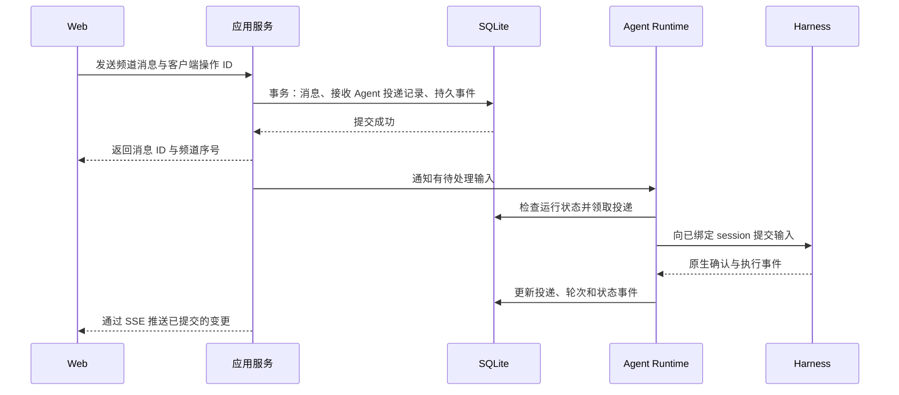

# Isles（群岛）架构设计

> 版本：0.7 · 日期：2026-09-30 · 状态：架构基线已认可，M1 已通过验收，M2 调度与权限规则已确认
>
> 产品语义以 [需求文档](requirements.md) 为准。本文整理技术选型、模块边界和关键运行流程；已实现范围与阶段验收见 [实现计划](implementation-plan.md)。
>
> “已确认”指用户已明确选择的内容；“建议”指本文提出的实现方案；“待确认”指需要产品决策或接入验证的事项。接口、表名、状态名及目录均为设计示意，尚未冻结。

## 1. 架构目标与约束

Isles 是一个让人类与独立 Agent 通过私聊、群聊协作的应用。平台承担通信、权限、持久化和运行管理，各 harness 承担模型调用、工具执行及原生上下文管理。

以下约束已确定：

1. 首版为单用户、单机 Web 应用，Web 服务与所有 harness 在同一台电脑或服务器上运行。
2. 每个 Agent 对应一个 harness、模型与实例，固定绑定一个原生 session。创建尚未完成时可以没有 session；创建成功后始终恢复该绑定。
3. 私聊、群聊和不同工作内容共享该 Agent 的原生 session。需要并行上下文时，由用户创建新的编号 Agent。
4. 只有用户能够创建 Agent。自然语言指定的 leader 身份不自动授予平台权限。
5. 拉群、私聊按 Agent 授权；未获授权的 Agent 看不到相应 MCP 工具，服务端同时校验调用。
6. 每个 Agent 具有独立工作目录和原生 session，不共享对话上下文；harness 的配置、登录、插件与长期记忆可以共用。Agent 间通过消息与显式共享的产物协作。
7. 消息历史由 Isles 保存；上下文压缩和原生 memory 由 harness 管理。
8. 协作分工和 review 可通过自然语言约定，平台不预设固定角色或统一任务流水线。

实现需要保持三种身份的区别：**Agent 是持续存在的参与者，session 是其原生上下文，进程是可以重启的运行载体。** 重启进程不意味着创建新 Agent 或新 session。

## 2. 技术选型

### 2.1 已确认的选择

| 部分         | 选择                                 | 责任                                                                       |
| ------------ | ------------------------------------ | -------------------------------------------------------------------------- |
| 前端框架     | Vue 3                                | 聊天、Agent 管理和运行状态界面。                                           |
| 组件         | shadcn-vue                           | 基础组件源码纳入项目，按产品交互调整。                                     |
| 样式         | Tailwind CSS                         | 布局、主题和组件样式。                                                     |
| 数据访问     | Drizzle ORM                          | TypeScript 表结构、查询与事务；配套 Drizzle Kit 管理迁移。                 |
| 首批 harness | Codex → Kimi Code → Claude Agent SDK | 以原生接口为主，Codex 为主要接入；DSH 与第三方 Claude ACP 不纳入第一阶段。 |

### 2.2 已确认的实施基线

用户已认可架构并授权按此初始化。依赖版本在各工作区清单和锁文件中固定；具体业务行为仍按文中待确认事项讨论。

| 部分           | 选择                      | 理由与边界                                                                                          |
| -------------- | ------------------------- | --------------------------------------------------------------------------------------------------- |
| 语言与共享协议 | TypeScript 严格模式 + Zod | 前后端共享业务协议类型，并校验运行时输入；当前 TypeScript 固定在兼容 Vue/ESLint 工具链的 6.0 系列。 |
| 前端构建       | Vue 3 + Vite              | 对应所选组件生态，提供独立 Web 客户端。                                                             |
| 前端服务端状态 | TanStack Vue Query        | 管理历史分页、配置查询和事件到达后的缓存更新；本地交互状态另行管理。                                |
| 后端           | Node.js LTS + Fastify     | 持续运行的服务，承载 HTTP、事件推送和 MCP 入口。                                                    |
| 工程组织       | pnpm workspace            | 一个仓库管理前端、后端和共享协议。                                                                  |
| 数据库         | SQLite，启用 WAL          | 适合单机部署；通过 Drizzle 与 better-sqlite3 访问，原生构建依赖由项目管理。                         |
| 浏览器通信     | REST + SSE                | REST 接收操作和查询，SSE 推送消息及运行状态。                                                       |
| MCP            | 官方 TypeScript SDK       | 实现协作工具；优先评估 Streamable HTTP，按各 harness 能力选择兼容传输。                             |
| 验证           | Vitest + Playwright       | 分别验证业务规则、运行管理和浏览器关键流程。                                                        |

SQLite 的 WAL 模式有利于读写并行，但仍存在单写者约束。业务事务应保持短小，模型调用、进程等待和网络操作必须在业务数据库事务之外进行。

M1 在读取和恢复业务状态前，先取得数据目录的单进程占用锁。独立的空数据库 `runtime-lock.sqlite` 仅持有 SQLite/操作系统独占锁，不存放业务数据；正常关闭或进程异常退出均会释放。第二个服务若使用同一目录，会在改动 Agent 与执行状态前被拒绝，避免多个 Runtime 同时驱动同一个 thread。

## 3. 系统结构

采用模块化单体：一个 Isles 后端进程承担首版服务，内部明确划分职责；harness 作为独立原生运行进程，由 Runtime 管理连接与生命周期。


图中的存储到 SSE 连线表示读取可重放事件并发布通知。SQLite 本身不承担消息推送。

| 模块               | 职责                                                          | 依赖边界                                           |
| ------------------ | ------------------------------------------------------------- | -------------------------------------------------- |
| Web                | 联系人、频道、消息、Agent 配置、状态与交互请求。              | 使用 Isles API，不直接连接 harness 或访问数据库。  |
| HTTP / SSE         | 识别用户、校验请求、序列化响应和事件。                        | 调用应用服务，避免在路由中实现调度或原生协议。     |
| MCP                | 识别调用 Agent、按权限提供工具、将调用转换为应用操作。        | 与 HTTP 共用业务和权限逻辑。                       |
| 应用服务与领域规则 | Agent 创建、成员关系、消息接收、权限检查、产物发布。          | 使用存储及 Runtime 接口，不依赖具体 harness 协议。 |
| Runtime            | 输入排队、防抖唤醒、固定 session 绑定、执行互斥、停止与恢复。 | 通过 adapter 使用原生能力，通过存储记录运行事实。  |
| Adapters           | 原生协议、事件转换、会话恢复、取消和审批回传。                | 保留各 harness 的能力差异，不自行创建聊天频道。    |
| 存储               | 表结构、事务、迁移、投递记录、事件和查询。                    | 承担持久化，不决定群聊如何分工。                   |
| 工作目录与产物     | Agent 目录、原生状态位置、文件引用及共享操作。                | 目录归属与操作系统隔离分别处理。                   |

Web API 和 MCP 是不同入口。二者共用应用服务，但调用者分别是人类身份和 Agent 身份，权限不能因进入同一个服务函数而混同。

## 4. 代码组织

保持少量工作区包，后端模块在一个应用内组织。下列模块按实现阶段建立，初始化仅包含当前使用到的部分：

```text
apps/
  web/
    src/
      components/ui/     # 引入的 shadcn-vue 基础组件
      features/          # 聊天、联系人、Agent 配置、运行状态
      api/               # HTTP 客户端、SSE 与缓存更新
  server/
    src/
      http/              # 用户 API 与 SSE
      mcp/               # MCP 传输、工具注册与身份上下文
      application/       # HTTP 与 MCP 共用的用例
      domain/            # Agent、频道、消息、权限规则
      runtime/           # Agent 控制器、排队、恢复、停止
      adapters/
        codex/
        kimi/
        claude/
      storage/           # Drizzle schema、查询与事务
      artifacts/         # 目录与共享产物
      config/
    migrations/          # 可审查的数据库迁移
packages/
  contracts/             # 前后端共享的业务请求、响应与事件定义
docs/
  requirements.md
  architecture.md
  implementation-plan.md
```

`contracts` 只共享对外协议和校验定义，不向浏览器导出数据库实体、进程管理代码或凭据。原生协议类型留在对应 adapter 内，转换为 Isles 事件后再提供给应用。

shadcn-vue 的基础组件与聊天业务组件分别组织，便于检查上游组件更新和本地修改。具体组件、状态库及消息列表虚拟化方案在界面实现时选择。

## 5. 数据与标识

### 5.1 建议的数据模型

以下是需要保存的事实，不是最终建表脚本。小型记录是否合表、字段类型和索引在实现时确定。

| 数据                           | 主要内容                                                                     |
| ------------------------------ | ---------------------------------------------------------------------------- |
| `agents`                       | 稳定 Agent ID、显示名称、harness、模型配置、目录、权限、用户期望的运行状态。 |
| `session_bindings`             | Agent 与原生 session 的绑定、原生状态根目录、harness 版本及恢复信息。        |
| `channels` / `channel_members` | 私聊或群聊、成员身份、加入退出信息及历史可见范围的依据。                     |
| `messages`                     | 消息 ID、频道序号、真实发送者、正文、回复关系、产物引用、创建时间。          |
| `deliveries`                   | 每个接收 Agent 对每条消息的投递状态及其关联执行轮次。                        |
| `delivery_attempts`            | 实际投递尝试、原生请求/turn 标识、确认结果及错误，用于恢复时核对。           |
| `runs`                         | Agent 的一次原生执行、开始结束状态、原生 turn 标识及关联输入。               |
| `interaction_requests`         | harness 发起的审批或问题、所属 Agent 和轮次、有效状态、用户答复。            |
| `events`                       | 可重放的消息与状态变更事件，供 SSE 和恢复查询使用。                          |
| `artifacts`                    | 文件 ID、所有者、存储位置、共享范围及可选版本信息。                          |

Agent ID 应独立于显示名称。名称中的 `harness-model-1/2/3` 表达用户看到的实例身份，不宜作为数据库外键、凭据身份或目录定位的唯一依据。

原生 session ID 需要结合 harness 和原生状态存储范围解释，不能假定不同 harness 返回的 ID 全局唯一。

### 5.2 三种顺序与游标

- **消息 ID**：引用和去重一条消息。
- **频道序号**：表示该频道的消息顺序；不同频道的序号没有先后可比性。
- **事件游标**：用于客户端增量同步与断线重连，不等同于某个频道的消息序号。

Agent 还需要投递进度。浏览器已读、模型通过历史工具看见内容、输入被原生接口接受，以及一次执行完成，都是不同事实，不能合并成一个 `read` 字段。

建议通过唯一约束保证频道序号和 `(Agent ID, 消息 ID)` 投递记录不重复。客户端操作 ID 与调用者身份一起用于请求去重；相同操作 ID 携带不同内容时应返回冲突。

### 5.3 消息身份与内容

平台内部保留频道、发送者类型、发送者 ID、消息 ID、序号与回复关系。它们由认证身份和存储记录生成，正文中的同名字段没有身份效力。

进入原生 session 时，再由 adapter 或统一输入编码器封装这些信息。M2 的 Codex 输入使用一条 JSON 文本信封（见 7.2）；其他 harness 的编码方式在接入时确认。

其他 agent 的发言即使通过原生 `user message` 输入，也必须标明其来源。模型看到的说明不能替代服务端的身份校验。

## 6. 关键流程

### 6.1 创建 Agent 与建立 session

建议的创建流程：

1. 用户提交 harness、模型及 Agent 配置，服务端确认调用者为人类用户。
2. 保存处于创建中的 Agent，分配稳定目录和该 Agent 的 MCP 身份。
3. 准备原生配置、工作目录、规则说明及所需凭据引用。
4. adapter 启动或连接原生服务，为该 Agent 创建一次原生 session。
5. 保存返回的 session 绑定，将 Agent 标记为可用。

后续消息、加入群组及执行 review 都使用已有绑定。恢复流程只调用原生恢复能力；恢复失败时显式报告。

创建也存在跨系统确认问题：若原生 session 已创建，但 Isles 尚未成功保存其 ID，不能盲目再创建一个。应记录创建尝试，依据可用原生查询核对；无法核对时显示待处理状态。

### 6.2 用户发送消息



接收范围依据消息发送时的频道成员关系生成，排除把发送者自己的发言再次自动投递给自己。发起原生输入前重新检查 Agent 停止状态和必要的访问权限；成员退出后的待投递消息如何处置需明确规则。

事务提交后，即使进程在发出通知前退出，消息和投递记录仍存在。Runtime 应在启动及运行中重新检查持久化待办，内存通知仅用于及时唤醒。

群内任何发言（用户或 Agent）都为除发言者以外的全体成员生成投递记录，并按第 7.2 节的防抖与合并规则唤醒。`@` 只标明特意对谁说，不改变接收范围。**可读取与立即启动一次执行是两件事**：暂停的群只保存消息，不产生唤醒。

### 6.3 agent 发言与输出路由

Agent 通过 MCP 发言时，服务端从连接身份取得发送者，再校验目标频道、成员关系与相应权限，复用同一条消息持久化流程。

对外消息必须具有明确目标频道。已确认从 M1 起正式聊天消息统一经 MCP 发布，原生最终输出仅作为执行详情展示，不自动转成聊天消息。

不能把未携带路由的原生输出默认广播，或简单归到最后收到消息的频道。一个 turn 可能处理多个频道的输入，消息归属不能仅从 turn 推断。

### 6.4 浏览器实时同步

建议 REST 承担发送消息、配置 Agent、查询历史、停止和回答交互请求；SSE 承担向浏览器通知新消息、Agent 状态、执行进度和待答请求。

持久化事件应具备游标，客户端重连后补读。若游标已过保留范围，客户端重新获取快照并接续订阅；快照与订阅需要有明确水位，避免切换间隙漏事件。

临时文本增量可以单独推送，是否落库由存储策略决定。只有持久化事件才承诺重放；临时增量丢失时通过已保存的消息或执行快照校正。

浏览器的 REST/SSE 与 adapter 使用的原生 WebSocket、ACP 或 stdio 是两组协议，互不要求采用同一种传输。

## 7. Runtime 与恢复

### 7.1 每个 Agent 一个运行控制器

每个 Agent 的 Runtime 持有固定 session 绑定、原生连接、待输入通知、当前执行和群消息防抖计时器。不同 Agent 可以并行；同一 Agent 在任一时刻只能存在一条由 Isles 管理的活动执行路径。

M1 已确认使用持久排队，不提供 steer。后续是否开放中途输入另行决定；切换频道不会生成新 session。

用户期望状态与观测状态分开保存：例如用户已要求停止，但原生执行仍在取消中，界面应呈现这一事实。

| 观测状态示意        | 含义                                                              |
| ------------------- | ----------------------------------------------------------------- |
| 创建中 / 恢复中     | 尚不能接收新的原生执行。                                          |
| 空闲                | 没有活动执行，可以按策略处理待投递消息。                          |
| 执行中              | 正在处理一个原生 turn。                                           |
| 等待消息 / 等待用户 | 活动执行正在等待工具结果、审批或回答，仍占用该 Agent 的执行路径。 |
| 停止中              | 已收到停止要求，正在等待原生取消结果或清理。                      |
| 已停止              | 新消息可以保存，但不能绕过停止状态自动启动。                      |
| 异常 / 状态待核对   | 原生状态或投递结果无法确认，需恢复核对或用户处理。                |

M1 的“停止 Agent”同时中断当前 turn 并持久化停止状态，新消息继续保存排队，只有用户显式“恢复 Agent”后才处理。调度前每次检查停止标记；仅中断单次 turn 而继续处理后续队列的独立操作不在 M1 范围内。

建议一个数据目录仅由一个 Isles 后端实例拥有，通过启动锁避免误启动两个调度器。进程级互斥本身不能处理跨重启的不确定状态。

### 7.2 唤醒、防抖与合并输入

M2 已确认不提供等待消息的 MCP 工具。新消息只经 Runtime 投递，Agent 不在执行中挂起等待，因此不存在工具返回与新 turn 重复呈现同一消息的第二条入口。

- **接收范围**：消息提交时，为频道内除发言者以外的每个成员写入一条投递记录；未投递的记录即该 Agent 的未读。
- **唤醒条件**：Agent 空闲且未停止时，私聊中的未读立即可唤醒；群内未读在该群安静 10 秒，或最早一条未读已等待 30 秒后可唤醒。暂停的群不参与唤醒，也不进入输入。Agent 忙碌时新消息继续排队，当前 turn 结束后重新判断。
- **合并输入**：一次唤醒只提交一条输入，包含所有未暂停频道的未读，不只是触发唤醒的频道。每个频道取最近 10 条未读，加上更早的全部 `@` 该 Agent 的未读；私聊中用户的消息都视为对该 Agent 说。其余未读标记为已跳过，只在输入中注明条数，可通过历史工具读取，不进入后续输入。
- **系统消息**：建群、改名、成员变化、暂停与继续以系统消息记录在群内，同样写入成员的投递记录，但不触发唤醒，只随其他未读进入下一次输入。新成员从加入后的消息开始接收投递，入群前的历史通过工具读取。
- **信封**：一条 JSON 文本输入，按频道分组并注明跳过的未读条数。每条消息携带频道类型与名称、平台生成的发送者身份与模型、消息 ID、序号、回复关系、被 `@` 的成员和是否 `@` 了该 Agent。正文中的同名字段没有身份效力。
- **计时**：防抖计时器只是唤醒提示；重启后依据持久化的投递记录与消息时间重新计算，不依赖内存状态。

原生 turn 已结束后，由 Isles 依据新消息和运行策略启动下一轮。MCP 通知本身不能被视为唤醒已结束模型执行的保证。

### 7.3 投递保证与不确定结果

Isles 可以通过数据库事务和去重键保证内部消息记录及待投递记录的一致性，但数据库与外部 harness 之间不存在共同事务。

需要明确区分：

| 事实                       | 可以得出的结论                                    |
| -------------------------- | ------------------------------------------------- |
| 消息已提交到 SQLite        | Isles 已接收并保存消息。                          |
| 原生接口确认接受输入       | harness 已接受输入，具体确认强度由 adapter 定义。 |
| 原生执行结束               | 此次执行已产生终态；不等于工作目标已经验收通过。  |
| 发送后连接断开，未收到确认 | 可能未接受，也可能已执行，结果待核对。            |

建议投递记录区分待投递、尝试中、已接受、明确失败和结果待核对，执行终态单独记录。发送前先记录尝试及关联信息，确认后再推进状态。

恢复时优先查询原生 session/turn 状态并核对。只有明确未被接受的输入才可以安全重试；无法核对的请求不能直接重发，以免重复执行 Git、文件或其他有副作用的操作。

这一设计不宣称跨 harness 的 exactly-once 执行，也不把所有重启后的未完成记录自动当作可重试。

### 7.4 重启与进程所有权

恢复顺序建议为：读取 Agent 期望状态与 session 绑定，核对旧进程及连接，恢复原生 session，核对未完成投递和交互请求，再恢复调度。

清理子进程时需要确认其确由该 Agent 的运行管理创建，避免仅凭旧 PID 操作其他进程。恢复未知执行前，不能假定连接断开就意味着原生工作已经停止。

## 8. MCP 与权限

### 8.1 Agent 身份

建议每个 Agent 具有独立 MCP 连接凭据或等价的可信绑定。身份来源由服务端建立，工具参数中的 `agent_id`、消息正文中的发送者名称都不能覆盖调用者身份。

M1 按用户决定暂不对管理入口做登录鉴权，只监听本机。MCP 仍使用 Agent 身份绑定和频道归属校验。此阶段的管理 HTTP API 不具备人类与本机进程间的身份隔离；后续用户鉴权需要单独实现，不能把当前接口称为仅人类可访问。

### 8.2 工具可见性与调用校验

工具列表按 Agent 权限生成，调用时再次检查最新权限和资源访问范围。缓存过的工具名称、直接构造的调用、通用消息接口均不能绕过校验。

工具候选如下，名称和参数尚未冻结：

| 能力                           | 授权依据                                                                            |
| ------------------------------ | ----------------------------------------------------------------------------------- |
| 查看可联系 Agent、所在群与成员 | 联系人目录列出全部 Agent 的名称与配置；频道与成员限于调用者所在频道。               |
| 读取、搜索消息                 | 频道访问权及允许读取的历史范围。                                                    |
| 群内发言、回复                 | 群成员关系及频道状态。                                                              |
| 拉群、邀请已有 Agent           | Agent 的拉群权限（M2 为一个权限，默认关闭）；只能邀请进自己所在的群，不能移除成员。 |
| Agent 之间私聊                 | M2 不实现；主动发起与回复的权限边界待确认。                                         |
| 发布、读取共享产物             | 所有权、共享范围与相应频道访问权。                                                  |

创建 Agent 不进入 MCP 工具集合。授权拉群只允许组织已有 Agent，不能借此创建新实例。

权限变更后，服务端校验立即采用新值；模型侧工具列表刷新方式由 adapter 能力决定。支持刷新时发送相应更新，不支持时需在安全边界重新连接并恢复原 session。生效时点和交互提示需验证后确定，不能把服务端已拒绝调用描述为模型侧工具已经消失。

M2 的 Codex adapter 不依赖原生的 MCP 热刷新：权限变更后，在该 Agent 空闲时关闭其原生进程，随即恢复同一 thread 并重新加载工具列表；执行中发生的变更在当前 turn 结束后生效。CLI `0.159.2` 提供 `config/mcpServer/reload`，其对已有 thread 工具列表的作用尚未验证，验证后可作为优化。

### 8.3 原生工具与权限范围

协作权限控制 Isles 的接口，不自动约束 harness 的全部 shell、文件和网络能力。若要求同机 Agent 之间具有强制隔离，需要操作系统、沙箱或容器配合。

harness 自带的子代理、fork、review 等能力属于该 Agent 自己，Isles 不禁止也不接管，由 Agent 自行决定是否使用。子代理不是 Isles Agent：没有自己的频道身份，不出现在联系人中，也不受“仅用户创建 Agent”约束。固定 session 约束针对的是 Isles：只向 Agent 的主 session 投递消息、只恢复主 session，不为频道、消息或任务新建或替换它。子代理经 Isles 工具的发言归属该 Agent。

Codex 的子代理设置沿用用户自己的 Codex 配置。子代理运行在该 Agent 的原生进程中，其 turn 事件不影响主 session 的执行状态；子代理在主 turn 执行期间提出的原生问题与主 session 的问题一样在 Web 回答。M1 曾在 Agent 配置中关闭 `features.multi_agent` 与 `features.multi_agent_v2` 并在启动规则中禁止子代理，2026-09-30 用户明确子代理属于 Agent 自身能力后取消。

## 9. Harness 适配

### 9.1 接口责任

建议 adapter 对 Runtime 暴露以下能力，具体 TypeScript 签名在协议验证后确定：

| 接口职责            | 语义                                                     |
| ------------------- | -------------------------------------------------------- |
| 检测版本与能力      | 报告实际版本、可用模型配置及已验证的协议能力。           |
| 启动 / 连接原生服务 | 建立协议连接，完成握手、认证和事件订阅。                 |
| 创建原生 session    | 仅用于创建新 Agent；返回可持久化的绑定信息。             |
| 恢复原生 session    | 加载已有绑定，失败时报告原因，不隐式创建替代 session。   |
| 提交输入            | 向绑定 session 提交一轮输入，并返回原生确认与关联信息。  |
| 中途输入 / 取消     | 仅在已支持的能力范围内执行，并报告确认与终态。           |
| 处理审批或用户问题  | 保留原生请求关联，将答复交回正确 session 和 turn。       |
| 接收事件            | 转换消息、工具、状态及错误事件，保留必要的原生关联信息。 |
| 断开 / 释放运行资源 | 关闭连接和所属进程；是否保留持久化 session 必须明确。    |

能力应逐项声明，包括恢复、查询历史、输入确认、steer、取消、审批、用户问题、文本增量、MCP 工具刷新和原生状态隔离。缺少某项能力时由 Runtime 和 UI 显式处理，不能用新 session 或猜测结果补齐。

审批或提问需要保存 Agent、原生 session、turn 和请求 ID。用户答复前检查请求是否仍有效，过期或已取消的请求不得被转交给后续执行。

M1 已确定 Codex 使用 `danger-full-access` 和 `approvalPolicy: never`，不提供执行权限审批弹窗；原生用户提问仍按关联请求处理。

### 9.2 首批原生接口

下表的接入路径与顺序已确定。Codex M1 已完成本地真实原生链路验证，Kimi 与 Claude 尚未接入。首先以 Codex 完成主要产品链路，然后接入 Kimi，最后接入 Claude Agent SDK。实施时锁定版本，保存该版本的协议依据并运行适配测试。

| Harness     | 接入接口                                | 已查明的接口边界                                                                                                                               |
| ----------- | --------------------------------------- | ---------------------------------------------------------------------------------------------------------------------------------------------- |
| Codex       | `codex app-server`，优先 stdio JSON-RPC | 提供 thread 创建/恢复、turn 提交、steer、取消和服务端请求；可从对应 CLI 版本生成 TypeScript 协议定义。                                         |
| Kimi Code   | `kimi web` 的 REST + WebSocket          | 官方提供 Server API；接口处于实验阶段，以安装版本实际提供的 `/openapi.json`、`/asyncapi.json` 为准。JSON 业务结果还需检查响应包络中的 `code`。 |
| Claude Code | 官方 Claude Agent SDK 的持续流式输入    | 官方 SDK 运行 Claude Code binary，提供会话、权限及 MCP 能力；第一阶段直接对接 SDK。                                                            |

使用子进程启动持续运行的 server 后，后续交互通过原生协议完成。连接重建与 session 恢复分别处理，不能把每条消息变成一次新的 CLI 执行。

Codex `0.158.0` 的空 thread 在首次历史写入前尚未落盘。M1 创建时使用 `thread/start(ephemeral: false)`，保存原生 ID，再通过 `thread/inject_items` 注入一次已有启动规则，成功后才标记可用。该初始化不调用模型，不创建 turn 或正式聊天消息；恢复只使用原 ID，不重复注入。此流程已验证空 thread 在关闭原生进程后仍可恢复。

DSH 不纳入第一阶段，原有 DSH ACP 能力限制不再作为首批实现的前提。三个 adapter 仍需分别验证事件、恢复、审批和 MCP 能力；历史与共享产物以协作工具提供的能力为基础。

Codex 按 Agent 运行独立原生进程，各自使用独立工作目录，共用用户的 `CODEX_HOME`：配置、登录、MCP server、插件、skills、全局 `AGENTS.md` 与长期记忆都是用户本人的那一份，Agent 的 session 也保存在其中。Isles 不复制、不写入该目录的配置，每个 Agent 的差异在 `thread/start` / `thread/resume` 的会话级 `config` 中传入：

- 自己的 Isles MCP 地址；bearer token 由 `bearer_token_env_var` 从该原生进程的环境变量读取，不进入配置文件和模型上下文。
- 项目根标记 `.isles-root`，使位于 Isles 仓库内的 workspace 不加载外层仓库的 `AGENTS.md`。
- 对 workspace 的会话级信任，避免 Codex 在启动 thread 时把 workspace 记入 `config.toml`。

Agent 记录创建时所用的 Codex 目录；当前目录与之不同时拒绝恢复并报错，不创建替代 thread。以上行为已在 `codex-cli 0.159.2` 上用真实 Codex 验证：用户自己的 MCP server 仍然可用，Isles 工具按权限出现，`config.toml` 前后一致。其他 harness 同样可以共用配置与记忆；无论如何，每个 Agent 的 session 必须独立，固定 session 约束始终成立。

### 9.3 Claude Code 官方 SDK 接入

**已确定直接使用官方 TypeScript Agent SDK。** 它的 streaming input 支持持续运行的交互进程，可向 `query()` 提供异步输入流，保留多轮上下文，并处理取消、权限请求与 MCP。Isles 的 Claude adapter 将 SDK 事件转换为平台事件。

调用链为 Isles Runtime → Claude adapter → 官方 Agent SDK → Claude Code 原生进程。第一阶段不引入第三方 ACP 桥接。

必须持久化准确的原生 `session_id`，恢复时使用指定 ID，不能仅用 `continue` 选择目录下最近的会话，也不能调用 fork 来恢复。官方 TypeScript SDK 文档说明旧 V2 `createSession()` / `send` / `stream` 预览 API 已移除，实施应依据当前 `query()` 和 session 选项。

接入时仍需验证恢复失败和上下文重置，并确认 Isles 始终恢复主 session；内置委派属于 Agent 自身能力，不作限制。工程初始化阶段不安装或运行该 SDK；在 Claude 接入阶段锁定实际版本并验证。

Claude Code 执行核心不因 ACP 桥接开源而成为开源 harness，其官方仓库许可为保留权利并适用 Anthropic 条款。本次按用户明确选择纳入第一阶段，后续扩展仍保持优先选择厂商开源 harness 的原则。

### 9.4 规则与原生状态

Agent 的启动说明应包括自身身份、频道信封语义、可用协作工具、权限边界、工作目录及跨频道交流规则。

具体通过 `AGENTS.md`、原生配置或 session 指令注入，由各 harness 的已验证能力决定。不能假定三个 harness 会在相同路径、相同时点读取相同文件。

## 10. 文件、记忆与持久化

建议使用一个可配置的数据根目录，下面的布局只表示归属关系：

```text
<data-root>/
  isles.sqlite
  agents/
    <agent-id>/
      workspace/         # Agent 自主组织的工作文件与仓库
      isles-mcp-token    # 该 Agent 的 MCP 身份
  shared/
    <artifact-id>/       # 显式共享的产物
```

SQLite 保存平台业务事实，harness 自己的目录保存 session 和 memory；Codex 使用用户的 `CODEX_HOME`，不在数据根目录下。单独恢复聊天数据库不能替代恢复原生 session。

Agent 可以共用 harness 的配置、插件与长期记忆，但不能共用或误恢复彼此的 session。adapter 必须验证 session 的存储与恢复在共用配置下仍按 Agent 独立。

产物建议通过服务发布后获得稳定引用，再发送到频道。是否复制快照、允许原地修改、启用哈希或版本，需要用户确认；历史消息引用可变文件时不能承诺内容永久不变。

Agent 可自行 clone、开发和执行 Git 操作。凭据分发与 push、PR、merge、deploy 的授权分别处理，群内 leader 的指示不自动覆盖用户授权范围。

迁移文件与 schema 一起审查和版本管理。数据库升级应有备份及失败处理；运行中的 SQLite 备份应使用一致性备份机制，不能假设只复制主数据库文件就包含 WAL 中的全部数据。完整恢复还需要协调原生状态目录与产物文件的一致性。

## 11. Web 交互边界

建议首版围绕以下页面区域组织：

- 联系人与群组列表：创建 Agent、查看实例身份、进入私聊和群聊。
- 聊天区：消息、回复关系、产物引用、历史分页和发送状态。
- Agent 配置：harness、实际模型配置、拉群/私聊权限、目录和原生能力信息。
- 运行详情：当前执行、工具活动、错误、停止状态和投递待核对事项。
- 用户交互入口：原生审批与问题，明确关联到哪个 Agent 和哪次执行。

聊天消息与执行日志分别展示。无目标频道的原生输出不能因打开了某个聊天页面就归入该频道。

用户应能区分“消息已保存”“等待 Agent 处理”“正在执行”和“等待用户”，并看见 session 无法恢复、能力不支持等实际状态。

UI 同样要说明：不同编号 Agent 具有独立上下文；同一 Agent 的私聊和群聊共享原生上下文。频道投递权限不能被呈现为该 Agent 内部的知识隔离。

## 12. 验证与搭建顺序

原生接入顺序已确定为 Codex → Kimi Code → Claude Agent SDK。更具体的产品阶段建议见 [实现计划](implementation-plan.md)：

1. 搭建工程、Web 外壳、服务启动、配置和迁移入口。
2. 依据 Codex 官方文档和版本对应的协议类型直接接入，完成单 Agent 私聊、固定 session、停止和恢复闭环；必要联调随功能开展，不单列前置协议验证阶段。
3. 以多个 Codex Agent 实现 MCP 群聊、权限、消息路由和协作。
4. 依次接入 Kimi 和 Claude Agent SDK，复用同一组行为契约并记录能力差异。
5. 完善产物共享、历史、生命周期与长期运行体验。权限和恢复从功能引入时就验证。

重点验证会破坏产品语义的故障：

| 场景                                 | 验证目标                                          |
| ------------------------------------ | ------------------------------------------------- |
| 同一 Agent 跨多个频道收消息          | 原生 session 不变，同一 session 不发生冲突执行。  |
| 两个同配置编号 Agent                 | 工作目录与 session 独立，配置与长期记忆可共用。   |
| 消息提交后、内存通知前退出           | 重启可发现待投递消息。                            |
| 原生接受输入后、Isles 保存确认前断线 | 进入核对流程，避免盲目重执行。                    |
| 撤销权限后继续使用缓存工具           | 服务端拒绝越权调用，工具列表按验证过的机制更新。  |
| 通用消息工具发送到私聊或未加入群     | 无法绕过私聊权限与成员范围。                      |
| 停止 Agent 后收到新消息或服务重启    | 保持停止约束，只有约定的恢复操作能重新调度。      |
| 多频道同时有未读、防抖计时到期       | 只启动一个 turn，合并输入且不重复呈现已投递消息。 |
| 原生审批过期或 turn 已结束           | 用户答复不会作用到其他执行。                      |
| SSE 重连或游标过期                   | 正确补读或重建快照，消息不重复显示、不静默遗漏。  |
| 原生 session 丢失或恢复失败          | 显式报告，不新建替代 session 伪装连续上下文。     |

浏览器验证应覆盖创建 Agent、私聊、拉群、权限配置和停止。真实 harness 验证独立于模拟 adapter 测试；接口文档、编译成功和模拟测试都不能替代实际接入验证。

## 13. 实施前及后续待确认事项

| 时点                | 需要确认的问题                                                                                                          |
| ------------------- | ----------------------------------------------------------------------------------------------------------------------- |
| 工程基线            | 技术选型已认可，按第 2.2 节初始化；版本记录在 package.json 和锁文件，后续升级需验证兼容性。                             |
| 开放 Web 访问前     | 监听地址、用户认证、远程浏览器访问、Agent 凭据管理和管理接口边界。                                                      |
| 实现消息调度前      | M2 已确认：群内发言唤醒全体成员、防抖、合并未读输入、不提供等待工具、不设讨论预算；steer 仍不提供。                     |
| 实现输出展示前      | 正式消息是否统一经 MCP；原生最终输出的展示和路由。                                                                      |
| 实现权限变更前      | M2 已确认拉群粒度、默认值与生效方式；Agent 之间私聊的发起/回复边界待确认。                                              |
| 接入每个 harness 前 | 原生路径和顺序已确定；继续验证版本、模型配置、session 恢复、状态隔离、主 session 与内置委派的区分、审批及原生能力差异。 |
| 实现生命周期操作前  | 改名、模型/harness 配置修改、暂停/恢复、归档与删除语义。                                                                |
| 实现历史和共享前    | 入群前历史、退群后访问、跨频道转述、产物版本及文件隔离强度。                                                            |
| 扩展协作约束前      | 是否增加可选的阶段和跨模型 review 门槛，以及审查产物的版本绑定。                                                        |
| 持续运行前          | 日志与事件保留、容量限制、备份恢复、原生进程异常及无法核对状态的处理。                                                  |

未来 Electron 可以复用 Web 界面及本地服务能力，IM 可以作为新的消息入口接入应用服务。多用户和跨机器运行需要重新设计身份、执行所有权、凭据和文件访问，首版只保留清晰模块边界，不承诺可以无成本扩展。

## 14. 接口依据

文档核对日期为 2026-09-29；以下资料用于解释候选方案，不表示已经完成本地运行验证。

- [Codex App Server 官方文档](https://learn.chatgpt.com/docs/app-server)：原生协议、thread/turn 生命周期、事件及审批。
- [Kimi Code Server API](https://moonshotai.github.io/kimi-code/en/reference/server-api)：REST、WebSocket、响应包络及安装版本的协议规范。
- [Claude Code CLI 参考](https://code.claude.com/docs/en/cli-reference)：官方公开命令、`stream-json`、指定 session 与恢复参数。
- [Claude Agent SDK 概览](https://code.claude.com/docs/en/agent-sdk)：SDK 与 Claude Code 原生进程的关系及能力范围。
- [Claude Agent SDK Streaming Input](https://code.claude.com/docs/en/agent-sdk/streaming-vs-single-mode)：持续交互、队列输入、取消和 MCP。
- [Claude Agent SDK Sessions](https://code.claude.com/docs/en/agent-sdk/sessions)：原生 session ID、resume 与 fork 的区别及旧 V2 API 移除说明。
- [Claude Code 许可](https://github.com/anthropics/claude-code/blob/main/LICENSE.md)：Claude Code 与开源桥接层的许可边界。
- [Drizzle 概览](https://orm.drizzle.team/docs/overview)：数据访问、schema、数据库驱动与迁移工具的职责。
- [shadcn-vue 简介](https://www.shadcn-vue.com/docs/introduction)：组件源码分发与项目内定制方式。
