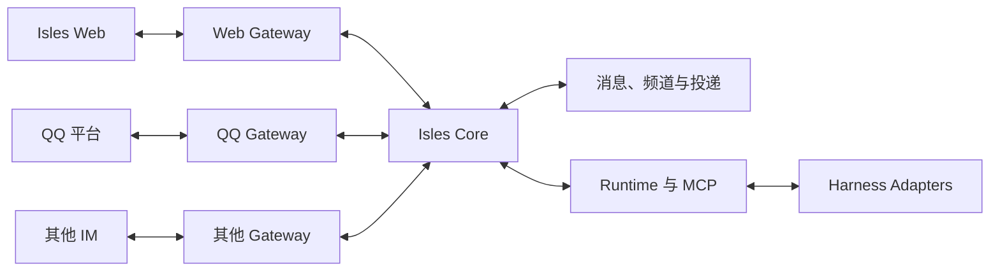

# 统一接入端（Gateway）设计方案

> 日期：2026-10-29 · 状态：设计提案，供评审。
>
> 本文记录已明确的 Gateway、Agent 与消息模型，并给出实现建议。剩余产品选择见第 12 节；当前已交付能力见[需求](requirements.md)、[架构](architecture.md)与[实现计划](implementation-plan.md)。

## 1. 目标与范围

用户已明确以下方向：

- 在 Isles Web 的 Agent 设置中配置 QQ Bot 等外部 Gateway 身份。每个 Bot 实例绑定一个 Agent，一个 Agent 可以绑定多个 IM 实例。
- 发送给某个 Bot 的消息投递给它绑定的 Agent。新私聊和群聊由对应 Gateway 自动建立频道并投递。
- Isles Web 是配置、展示和聊天界面，也提供内置 Web Gateway。各 Gateway 的频道使用统一的聊天与消息处理。
- Agent 通过必填的 `gateway` 和 `channelId` 选择发送目标。收信可按 Gateway 筛选，也可以一次接收所有已有渠道。
- Web 中的人类显示名为 **Admin**；外部 IM 的发送者显示平台用户名或昵称。
- 每个 Agent 继续使用一个当前原生 session，来自 Web 和各 IM 的消息共享该 Agent 的上下文。

本方案建议首轮在现有单机部署中引入内置 Web Gateway 和 QQ Gateway，保留其他 IM 的统一接入契约。具体平台能力、接口细节和阶段安排作为建议，随接入验证和产品确认完善。

## 2. 核心概念与寻址

| 概念       | 标识                  | 含义                                                 |
| ---------- | --------------------- | ---------------------------------------------------- |
| 接入类型   | `GatewayAdapter.kind` | 一种协议实现，例如 `web`、`qq`。                     |
| 接入实例   | `gateway`             | 一份持久配置与身份，例如内置 Web 或一个 QQ Bot。     |
| 绑定 Agent | `boundAgentId`        | IM 实例代表和接收消息的 Agent。                      |
| 频道       | `channelId`           | Gateway 下的一段私聊或群聊，拥有独立历史与序号。     |
| 参与者     | `senderId`            | 人类、Agent、平台机器人或系统在 Isles 中的稳定身份。 |
| 原生会话   | `session`             | Agent 的模型上下文，由 harness 管理。                |

`gateway` 参数使用实际接入实例的稳定 ID。存储中的对应字段可命名为 `gatewayId`；工具及公开接口统一使用 `gateway`。`channelId` 在 Isles 内全局唯一，属于一个 Gateway。发送和历史查询同时使用这两个完整 ID，服务端校验归属关系。

Gateway 的显示名称、频道名和参与者名称用于展示。平台原生账号及会话 ID 按 Gateway 与平台作用域映射，路由使用 Isles ID。

建议首轮同一外部会话在一个 Gateway 下对应一个频道。两个 Bot 加入同一物理群时，各自建立频道视图；多个 Gateway 是否共享同一 Core 频道留待确认。跨 Bot 的平台身份按各自作用域验证。

```text
Agent Alice
  ├─ Web Gateway：私聊、已加入的 Web 群
  ├─ QQ Bot A Gateway：Bot A 的私聊和群
  └─ 其他 IM Gateway：该实例的私聊和群

Agent Bob
  ├─ Web Gateway：私聊、已加入的 Web 群
  └─ QQ Bot B Gateway：Bot B 的私聊和群
```

## 3. 模块与职责



| 模块           | 职责                                                            |
| -------------- | --------------------------------------------------------------- |
| Gateway        | 管理接入实例与连接，归一化平台事件、身份、内容和发送结果。      |
| Isles Core     | 管理参与者、频道、消息、权限、历史、Agent 投递及平台发送记录。  |
| Runtime 与 MCP | 调度 Agent 输入，提供统一消息工具并维护当前原生 session。       |
| Web            | 配置 Agent 和 Gateway，展示频道、消息与发送状态，提供聊天入口。 |

Gateway 处理平台协议、媒体上传下载、回执和能力差异；Core 处理共同的消息规则。Harness 使用统一消息输入与 MCP 接口，继续执行模型和原生工具。

Web Gateway 复用 REST、SSE 和事件游标。Web 可以浏览各 Gateway 的频道；聊天发送按所选 `gateway` 与 `channelId` 进入统一消息服务，发送者由可信调用身份确定。Web 直接使用 Bot 发送身份的具体入口与权限见第 12 节。

当前 Web 管理入口沿用单机、本机监听的部署场景。外部事件由已验证的 Gateway 连接或事件入口提交，实例凭据保存在服务端。

## 4. 身份、私聊与群聊

### 4.1 Agent 与 Bot 绑定

外部 Gateway 在启用前配置并验证 `boundAgentId`。一个实例固定代表一个 Agent；同一 Agent 可以配置多个外部实例。

Gateway 的连接状态、平台账号和绑定关系在 Agent 设置中展示。Bot 凭据、平台身份和 Agent ID 分别保存，供连接与消息处理使用。

同一平台账号由一个有效实例管理，重复配置时定位已有绑定。`list_gateways` 包含绑定当前 Agent 的实例，包括尚未收到首条来信的实例，以及该 Agent 可使用的内置 Web Gateway。

已启用实例的绑定调整、历史归属与在途消息处理作为待确认的生命周期选择。接入实例改名或重新连接时沿用实例 ID。

### 4.2 参与者与显示名

Web 人类参与者的显示名为 `Admin`。外部人类和机器人的显示名采用平台用户名或昵称；昵称为空时使用基于稳定身份生成的短 ID 标签。Agent 在 Web 的发言显示 Agent 名称，在外部 IM 的发言显示其绑定 Bot 的平台昵称。

Core 持久化发送者的稳定 ID、类型及关联关系。外部身份按 Gateway、平台命名空间、会话作用域和原生身份标识映射；同名、改名和跨平台账号都按实际身份记录处理。

消息、工具目录和历史中的名称使用一致的消歧规则。同名参与者或频道附加可区分的短 ID；平台昵称与消息正文承担展示和内容用途，身份与权限由可信连接和服务端记录确定。

### 4.3 私聊

Web 私聊由 Admin 与目标 Agent 建立；新建 Agent 后继续拥有自己的 Web 私聊入口。

外部 Bot 收到私聊事件时，Gateway 根据绑定关系定位 Agent，按外部会话键查找或建立频道，为该 Agent 建立投递。一个 Agent 可以通过多个 Bot 接收多段私聊，每段频道独立保存消息、回复和未读。

### 4.4 群聊

Web 群根据已有 Agent 成员分发消息。外部 Bot 收到群消息时，在所属 Gateway 下查找或建立群频道，并向绑定 Agent 投递。

外部频道的本地接收成员是该 Gateway 绑定的 Agent；平台上的人类和其他机器人作为观察到的参与者记录。其他 Agent 通过各自绑定的 Bot 参与外部群。平台群成员目录的完整程度按实际能力展示。

在 Web 群中邀请已有 Isles Agent 沿用现有协作权限。外部平台的 Bot 入群和成员操作按平台提供的方式处理。

## 5. 统一消息与模型输入

### 5.1 正式消息

正式消息继续以 `(channelId, seq)` 唯一定位，`seq` 按 Core 提交顺序在频道内递增。消息包含发送者身份、正文、图片、同频道回复、提及和创建时间；消息视图携带所属 `gateway`。

Web、QQ 和其他 IM 的消息沿用同一套持久化、队列、回执、历史读取和 Agent 调度。Agent 的正式发言由 `send_message` 发布；原生执行输出和子代理活动继续保存在执行详情。

平台发送时间、外部消息 ID、原生回复及事件映射保存在 Gateway 传输记录中。平台回复对应已保存消息时映射到该频道的 `seq`；暂未关联的引用保留可用资料，确认后补齐关联。

### 5.2 模型可见格式

普通输入、steer 和 MCP 收信与历史采用同一套消息块。每组提供 Gateway 和频道的完整地址，`from` 使用发送者的显示名。

```text
[gateway: "11111111-1111-4111-8111-111111111111", gateway_name: "工作 QQ", channel: "项目讨论", channel_id: "22222222-2222-4222-8222-222222222222"]

[channel: "项目讨论", seq: 12, from: "小王"]
请检查刚发的图片。

[channel: "项目讨论", seq: 13, from: "Alice", reply_to: 12]
我会检查布局和文字。

[gateway: "33333333-3333-4333-8333-333333333333", gateway_name: "Isles Web", channel: "与 Alice 的私聊", channel_id: "44444444-4444-4444-8444-444444444444"]

[channel: "与 Alice 的私聊", seq: 8, from: Admin]
请整理检查结果。
```

频道名和参与者名称按 JSON 字符串安全转义；同名标签按稳定 ID 消歧。正文、分页、截取和图片标签使用同一目录快照，正文转义沿用[消息协议](message-protocol.md)。

### 5.3 图片与平台能力

各渠道沿用[图片消息规则](image-messages.md)：普通回合提供原生图片内容，steer 提供 Agent 工作区内的图片路径，MCP 收信和历史返回图片内容块。Agent 发送图片时通过 `imagePaths` 保存快照。

Gateway 声明文本、图片、大小限制、回复、提及、格式、主动发送及平台回执等能力；频道结合平台账号和会话状态确定当前可用能力。平台图片先经过现有校验并保存，再进入统一投递链路。

平台原生回复、提及或格式按可用能力转换。提及使用目标在当前 Gateway 和会话作用域内有效的原生身份；其他情况使用可读名称并保留 Core 提及关系。能力不足时返回具体状态及可执行的处理方式。

## 6. MCP 接口建议

所有工具的 Gateway 参数命名为 `gateway`，值为实际实例 ID。

| 工具                              | 参数                                | 语义                                               |
| --------------------------------- | ----------------------------------- | -------------------------------------------------- |
| `list_gateways`                   | 无                                  | 列出当前 Agent 可访问的实例及能力。                |
| `list_channels`                   | 可选 `gateway`、`kind`              | 列出已加入频道，返回每个频道的完整地址。           |
| `list_participants`               | `gateway`、`channelId`              | 查询频道内可见参与者的 ID、类型和显示名。          |
| `send_message`                    | 必填 `gateway`、`channelId`         | 向指定频道发布正式消息。                           |
| `read_messages`                   | 必填 `gateway`、`channelId`         | 读取该频道历史并确认实际返回的消息。               |
| `receive_messages`                | 可选 `gateway`、`channelId`         | 按筛选条件接收排队消息；省略筛选接收所有已有渠道。 |
| `list_agents`                     | 无                                  | 查询 Isles Agent 目录。                            |
| `create_group`、`invite_to_group` | 目标 Web Gateway 及必要的频道和成员 | 按现有权限创建 Web 群或邀请已有 Agent。            |
| `get_message_delivery`            | `gateway`、`channelId`、`seq`       | 建议提供平台发送状态查询。                         |

发送示例：

```json
{
  "gateway": "11111111-1111-4111-8111-111111111111",
  "channelId": "22222222-2222-4222-8222-222222222222",
  "body": "检查完成，这是修改后的图片。",
  "imagePaths": ["F:/projects/demo/result.png"],
  "replyTo": 12,
  "clientId": "review-image-12"
}
```

`send_message` 返回频道内的 `seq`，表示正式消息及所需投递已保存。平台发送状态单独查询。调用方使用稳定 `clientId` 重试同一内容；相同 ID 与不同内容返回冲突。

`read_messages` 使用完整 Gateway 和频道地址。`receive_messages({ gateway })` 接收该实例范围内的排队消息；同时提供频道时取对应范围。服务端对全部调用校验 Agent 身份、频道归属、成员关系及能力，筛选之外的消息保持原状态。

Agent 访问外部频道时，Core 校验其身份与 Gateway 的 `boundAgentId` 一致；Web 频道按既有私聊和群成员关系校验。完整频道 ID 由目录提供，Web 默认私聊入口可保存明确的 `defaultChannelId`。

## 7. 收发、投递与恢复

### 7.1 入站

1. Gateway 验证平台连接或事件，并从实例配置取得绑定 Agent。
2. 保存事件及去重键，解析外部身份、频道、内容、回复和提及；所需媒体经过校验后保存。
3. 按 Gateway 与外部会话键查找或建立频道，建立绑定 Agent 的本地成员关系。
4. 在同一事务中保存正式消息、Agent 投递、外部消息映射及事件处理状态。
5. 提交后通知 Web 和 Runtime，按现有运行状态、忙碌排队和 steer 规则处理。

首次消息并发到达时复用同一频道；消息和 Agent 投递通过唯一键保持一致。平台提供事件确认时，在持久化后确认；重放与恢复范围由适配器实际能力确定。

事件去重键和平台消息映射分别维护。消息级映射按 Gateway、会话作用域及适配器归一化的外部消息键唯一；该键包含平台消息 ID 及平台要求的必要索引，相同平台消息复用同一个正式消息引用。

### 7.2 出站

1. 发送者选择 `gateway` 和 `channelId`，Core 校验身份、归属、成员关系和频道能力。
2. 正式消息、需要的 Agent 投递及平台发送任务在同一事务中保存。
3. Runtime 处理 Agent 投递；对应 Gateway 按频道发送顺序处理平台任务。
4. Gateway 持久化发送尝试和分片状态，再调用平台；保存回执与外部消息映射。

外部来信已由平台送达，Core 保存后进入 Agent 投递。Agent 通过绑定的 Bot 在目标频道发布消息。各入口的聊天使用同一套正式消息与发送流程，Web 直接使用 Bot 身份的入口和权限留待确认。

### 7.3 回执与幂等

| 事实         | 记录                | 含义                                      |
| ------------ | ------------------- | ----------------------------------------- |
| 正式消息保存 | `messages` 与 `seq` | Core 已保存消息。                         |
| Agent 接收   | `deliveries`        | 原生输入被确切接受，或 MCP 实际返回内容。 |
| 平台发送     | Gateway 发送记录    | 平台接受、明确失败或结果待核对。          |
| 原生活动     | `runs`              | Agent 执行状态与结果。                    |

平台回执、Agent 接收和执行完成分别呈现。发送任务可按 `pending`、`sending`、`accepted`、`retry_wait`、`uncertain` 等状态记录；具体状态名随实现确定。

外部请求前持久化尝试 ID 与发送状态。恢复时根据平台幂等键、查询结果或确切回执核对；结果待核对的尝试保留处理入口。已确认未发送的部分可以重试，已接受的分片保留映射。

### 7.4 回显与多 Bot

当前 Gateway 自身发送消息的回显与对应出站记录关联，避免重复建立正式消息和 Agent 投递。回显先于发送响应时先保存传输事件，待可信关联键或外部消息 ID 可用后结算。

其他 Bot 的来信按平台实际提供的事件作为参与者消息处理。来源能够可信映射到 Isles Agent 时关联该 Agent；其他情况保留平台机器人身份。跨 Bot 账号和群身份按各自 Gateway 作用域验证。

多个 Bot 的独立频道可以各自收到同一物理群中的消息。平台是否提供机器人间事件、提及方式和身份映射能力，在 QQ 接入验收时确认。

### 7.5 生命周期

Gateway 断线或停用时保留历史、已保存的事件和待发任务；恢复后继续可确定的处理。Agent 停止时新消息排队，恢复后继续投递。

Agent 显式新建 session 时，沿用现有规则取消该 Agent 所有频道中已有的待投递消息。删除 Agent、删除频道、调整 Bot 绑定及在途平台回执的具体处理纳入实现前确认。

## 8. 数据与事务建议

| 数据                                    | 主要内容                                                               |
| --------------------------------------- | ---------------------------------------------------------------------- |
| `gateways`                              | 实例 ID、类型、名称、凭据引用、连接状态、能力及 IM 的 `boundAgentId`。 |
| `participants`、`gateway_identities`    | 稳定参与者、显示名与按平台作用域保存的身份映射。                       |
| `channels`、`channel_members`           | Gateway 归属、会话映射、频道序号、本地 Agent 成员及观察到的参与者。    |
| `messages`、`deliveries`                | 正式消息及每个接收 Agent 的投递状态。                                  |
| `gateway_inbox`、`gateway_message_refs` | 入站事件、消息去重、平台引用和回显关联。                               |
| `gateway_outbox`、分片与尝试            | 待发消息、平台任务、发送结果和恢复信息。                               |
| `runs`                                  | Agent 的原生活动及输入引用。                                           |

外部会话映射建议以 `(gatewayId, conversationNamespace, externalConversationId)` 为唯一键。每条消息与每个 Agent 的投递组合唯一。成员、正式消息和待发记录以事务保持一致，网络调用与媒体准备在事务外执行。

存储更新采用[首发前数据政策](requirements.md#12-首次发布前的数据政策)的当前 schema 基线。

## 9. Web 交互建议

- **Agent 设置**：添加和管理该 Agent 的 QQ Bot 等 Gateway 身份，显示连接状态、实例名称和能力。
- **会话列表**：统一展示 Web 和外部频道，提供 Gateway 筛选与来源标记。
- **频道详情**：展示所选 Gateway、频道、参与者、绑定 Agent、共享目录及可用能力。
- **消息与状态**：显示 Admin、外部昵称和 Agent 名称，以及 Agent 接收和平台发送状态。
- **聊天输入**：按所选 `gateway` 与 `channelId` 提交普通消息，显示当前发送目标。
- **已保存范围**：按平台实际提供的事件展示已接入消息及接入时间。

接入身份配置展示 Agent 已参与的频道、可访问目录和原生工具权限，便于选择同一个 Agent 的跨渠道上下文范围。

## 10. QQ 首轮接入建议

1. 在 Agent 设置中配置 QQ Bot，验证平台身份与绑定 Agent 后启用。
2. 接收平台实际提供的私聊和群消息事件，自动建立频道并投递给绑定 Agent。
3. 完成统一文本收发、消息映射、回复、发送状态和断线恢复。
4. 接入图片上传下载，复用普通输入、steer 和 MCP 图片链路。
5. 验证多个 QQ Bot、群消息范围、平台限制、自身回显和其他 Bot 的消息。

可参考 [QQ 消息收发概述](https://bot.q.qq.com/wiki/develop/api-v2/server-inter/message/overview.html)、[私聊事件](https://bot.q.qq.com/wiki/develop/api-v2/autogen/event/c2c_message_create.html)、[群消息事件](https://bot.q.qq.com/wiki/develop/api-v2/autogen/event/group_at_message_create.html)及[官方 Node.js SDK](https://github.com/tencent-connect/qqbot-nodejs)。本地 `dsh-qqbot` 也提供连接和媒体实现参考。

## 11. 实施拆分与验收

### 11.1 建议阶段

| 阶段               | 交付                                                     | 验收重点                             |
| ------------------ | -------------------------------------------------------- | ------------------------------------ |
| G0：设计确认       | 确认第 12 节选择，更新产品需求与实施范围。               | 绑定、地址与频道语义一致。           |
| G1：Core 与 Web    | Gateway、参与者、泛化频道、消息服务与 MCP 参数。         | Web 私聊、群聊、图片及固定 session。 |
| G2：QQ 文本        | Agent 绑定、事件归一化、自动建频道、文本收发与持久投递。 | 私聊、群聊、多实例及断线恢复。       |
| G3：媒体与真实验收 | QQ 图片、平台能力、回显和多个 harness 验证。             | 完整消息链路与平台回执。             |

### 11.2 现有代码影响

| 位置                                                                      | 计划调整                                                |
| ------------------------------------------------------------------------- | ------------------------------------------------------- |
| `packages/contracts/src/index.ts`                                         | Gateway、参与者、频道、消息和工具地址。                 |
| `apps/server/src/storage/schema.ts`、`store.ts`                           | Bot 绑定、泛化人类身份、频道成员、映射与收发事务。      |
| `apps/server/src/app.ts`、`mcp/server.ts`                                 | Web 与 MCP 共用的消息入口、身份校验和 Gateway 参数。    |
| `apps/server/src/runtime/runtime.ts`                                      | 接收统一消息，保留每 Agent 调度、读取锁和固定 session。 |
| `runtime/envelope.ts`、`runtime/names.ts`、`resources/AGENTS.template.md` | Gateway 地址、Admin 和外部昵称的消息格式及规则。        |
| `runtime/images.ts`、`chat/markdown.ts`                                   | 平台图片导入与多参与者历史导出。                        |
| `apps/web/src/api/`、`components/`、`lib/channels.ts`                     | Agent 接入设置、频道筛选、身份显示与投递状态。          |
| `packages/config/src/index.ts`                                            | Gateway 实例配置及凭据引用。                            |

### 11.3 验收场景

- 为一个 Agent 配置多个 Gateway；每个 Bot 的私聊和群消息均投递给其绑定 Agent。
- 多个 Gateway 使用相同的原生用户、会话或消息 ID 时，身份、频道和去重保持独立。
- 新频道的并发首批消息只建立一个映射，每条消息对绑定 Agent 建立一次投递。
- `send_message` 和 `read_messages` 使用必填 `gateway` 与 `channelId`；错误归属和越权访问返回明确结果。
- 不指定 Gateway 时收取所有已有渠道；按 Gateway 筛选时其他渠道的消息保持原状态。
- Web 显示 Admin，外部消息显示用户名或昵称；同名、改名和空昵称都可识别。
- 同一 Agent 跨 Web、QQ 私聊和群聊使用同一原生 session，图片和 steer 沿用既有规则。
- 自身回显、其他 Bot 来信、重复入站、发送中断及迟到回执分别得到正确处理。
- 平台发送、Agent 接收与原生活动显示各自状态；停止、恢复和重启保持既有调度语义。

代码阶段运行受影响模块检查与项目完整检查；真实 QQ 验收使用确认的测试 Bot、联系人和群。

## 12. 实施前的产品选择

以下事项作为建议或待确认选择，确认后更新需求和实施计划：

| 事项              | 待确认内容                                                                |
| ----------------- | ------------------------------------------------------------------------- |
| 多 Bot 群视图     | 首轮建议各 Gateway 保持独立频道；确认后续是否共享同一物理群的 Core 频道。 |
| QQ 事件范围       | 核实平台私聊、群消息、机器人间消息和提及能力，以及各自的接收范围。        |
| Bot 绑定调整      | 确定实例转交其他 Agent 时的身份、历史、排队消息和在途回执处理。           |
| Web 使用 Bot 身份 | 确定 Web 直接使用 Bot 发送身份的入口与权限。                              |
| 跨平台身份        | 确定同一人的账号关联方式及展示。                                          |
| 平台内容能力      | 确定回复、提及、图片、格式和暂未覆盖的媒体类型。                          |
| 生命周期          | 确定删除 Agent、频道或 Gateway 时的连接、队列与历史处理。                 |
