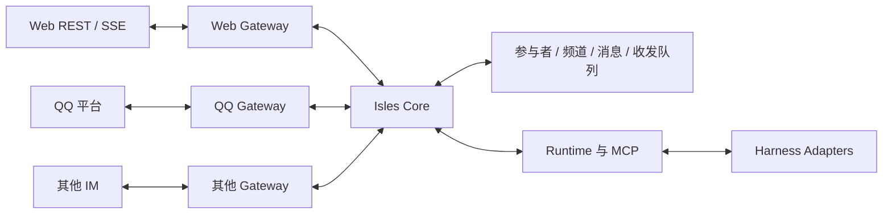

# 统一接入端（Gateway）设计方案

> 日期：2026-10-29 · 状态：设计提案，供评审。
>
> 本文描述 Web、QQ 与后续 IM 共用 Isles 消息核心的方案。接入模型、接口和阶段安排属于建议；实施前的产品选择集中在第 12 节。当前已交付能力见 [需求](requirements.md)、[架构](architecture.md)与[实现计划](implementation-plan.md)。

## 1. 目标与范围

用户提出的方向是：Isles Web 和各 IM 都作为接入口，消息格式、MCP 收发和 Agent 运行保持一致，通过接入端标识区分来源与目标。

本方案建议将产品分为三层：

1. **接入端**：连接 Web、QQ 等消息界面，处理原生事件、账号、媒体和发送结果。
2. **Isles Core**：管理参与者、频道、正式消息、权限、历史和持久化投递。
3. **Agent 运行层**：通过 MCP 和 Runtime 收发统一消息，继续使用各 harness 的原生 session。

首轮落地范围建议为单机、一个本地管理者、内置 Web 接入端和 QQ 接入端。外部联系人参与聊天，本地管理者配置接入端与 Agent。跨 IM 的同人绑定、频道桥接、平台文件库和外部管理命令作为后续独立能力。

沿用已实现的约定：

- 每个 Agent 保持一个当前原生 session，私聊、群聊和不同接入端的输入共享该上下文。
- 正式消息以 `(channelId, seq)` 定位；原生输出与子代理活动继续显示在执行详情。
- Agent 通过 `send_message` 发布正式回复，通过自动投递、steer 或 MCP 获取输入。
- 普通回合使用原生图片；steer 提供本地图片路径；MCP 收信与历史读取直接返回图片内容块。
- 工作目录和权限属于 Agent；全局及群共享目录继续按现有追加规则生效。
- 数据实现采用当前 schema 的全新基线，按项目[首发前数据政策](requirements.md#12-首次发布前的数据政策)执行。

## 2. 命名与寻址

### 2.1 核心概念

| 概念     | 建议名称                   | 含义                                                    |
| -------- | -------------------------- | ------------------------------------------------------- |
| 接入类型 | `GatewayAdapter.kind`      | 协议实现，如 `web`、`qq`。                              |
| 接入实例 | `Gateway` / `gatewayId`    | 一份持久配置与平台账号，如“Isles Web”“工作 QQ 机器人”。 |
| 会话     | `Channel` / `channelId`    | 一段私聊或群聊，拥有独立历史和递增序号。                |
| 参与者   | `Participant` / `senderId` | 人类、Agent 或系统的稳定 Isles 身份。                   |
| 外部身份 | `GatewayIdentity`          | 某接入实例所识别的平台用户，与参与者关联。              |
| 原生会话 | `session`                  | 某个 Agent 的模型上下文，由 harness 管理。              |

Gateway 表示双向接入实例。一个 QQ 机器人配置对应一个 Gateway；多个浏览器窗口共用同一个内置 Web Gateway。模型、Agent、浏览器标签页和群聊各自使用所属概念的标识。

`gatewayId`、`channelId`、`senderId` 使用稳定的 Isles UUID。名称用于显示，平台 OpenID 等原生标识保存在映射记录。接入端改名、重连和凭据轮换保留 ID；更换平台账号时创建新的接入实例。同一平台账号命名空间由一个有效实例管理，重复配置时定位已有实例。

### 2.2 频道归属与操作入口

建议第一版每个频道归属一个 Gateway，`channelId` 在整个 Isles 实例内唯一：

- 发送时以 `channelId` 查得目标 Gateway；可选的 `gatewayId` 用于一致性校验。
- 收信和频道查询中的 `gatewayId` 用于筛选，并与调用者可访问的频道取交集。
- 频道响应和消息视图包含 `gatewayId`；消息视图中的值从频道归属派生。
- 原生会话映射按 `(gatewayId, conversationNamespace, externalConversationId)` 唯一。
- 同一个 QQ 群通过两个机器人接入时，各自拥有频道、消息映射和发送队列。跨接入合并由后续桥接配置表达。

Web 同时承担聊天入口和管理界面。在 Web 打开 QQ 频道并发言时，目标仍是该 QQ Gateway。操作入口作为可信来源信息单独记录：

| 操作               | 目标频道所属 Gateway | 操作来源                 |
| ------------------ | -------------------- | ------------------------ |
| Web 自有会话发言   | 内置 Web             | Web 管理者               |
| QQ 用户发来私聊    | 对应 QQ 机器人       | QQ 事件及外部身份        |
| Web 中回复 QQ 私聊 | 对应 QQ 机器人       | Web 管理者               |
| Agent 回复 QQ 群   | 对应 QQ 机器人       | 绑定该 Agent 的 MCP 调用 |

同一个 `gatewayId` 参数始终表示频道的接入归属。操作来源由服务端建立，用于审计和防止回流。

## 3. 模块边界



| 模块            | 责任                                                                             |
| --------------- | -------------------------------------------------------------------------------- |
| GatewayRegistry | 注册接入类型，加载实例，提供状态和能力目录。                                     |
| GatewayAdapter  | 认证平台连接、解析事件、规范化外部标识、获取媒体、渲染和发送消息、解释平台回执。 |
| GatewayService  | 协调实例生命周期、身份和会话映射、入站去重、出站队列、重连与恢复。               |
| 消息应用服务    | 统一校验调用者、频道和内容，原子保存消息与投递记录，提交后通知 Runtime 和 Web。  |
| Runtime / MCP   | 维持每 Agent 的调度和会话语义，使用统一频道和消息接口。                          |
| Web 管理界面    | 配置接入端、参与者和接待 Agent，展示各频道历史、原生活动和平台发送状态。         |

接入端调用公共应用服务。HTTP、MCP 和平台事件使用不同的可信调用上下文，随后进入同一套消息规则。网络请求和媒体下载在数据库事务之外完成。

Web 管理入口沿用当前单机、本机监听的部署场景，本地调用上下文对应管理者。QQ 首轮优先使用 SDK 的主动连接；平台事件通过已验证的 Gateway 上下文进入专用入站服务。后续采用 webhook 的接入端使用独立的事件验证入口，与管理路由分别配置。

建议新增 `apps/server/src/gateway/`，放置契约、注册表、生命周期及 `web/`、`qq/` 实现；新增消息应用服务集中现有 HTTP 与 MCP 发布路径。GatewayAdapter 的主要操作为：

| 操作       | 输入 / 输出                                                    |
| ---------- | -------------------------------------------------------------- |
| 启动与关闭 | 实例配置、凭据引用、Core 事件接收器；连接状态和可恢复游标。    |
| 规范化入站 | 外部事件转换为来源身份、会话键、去重键、内容和回复引用。       |
| 查询能力   | 返回实例、会话及当前账号权限决定的有效能力。                   |
| 准备出站   | 统一消息转换为有序发送分片及原生回复上下文。                   |
| 发送分片   | 返回平台接受、明确失败或结果待核对，并携带可用的外部消息标识。 |

Web Gateway 使用现有 REST、SSE 和事件重放提供本地聊天能力。Web 自有消息以 Core 持久化及可重放事件作为本地交付依据，浏览器按游标恢复记录；外部频道另有平台发送队列。管理界面的跨频道查询复用 Core 查询接口。

## 4. 身份、私聊与群聊

### 4.1 统一参与者

建议增加统一参与者目录，沿用 `user / agent / system` 三种发送者类型：

- 人类拥有稳定 `senderId`、名称和备注；本地管理者也是一位人类参与者。
- Agent 的参与者 ID 与 Agent ID 一致；harness、模型、目录和运行配置仍保存在 Agent 记录。
- 系统消息拥有固定的系统参与者。
- 名称修改更新显示目录，消息保持原作者 ID；同名时使用现有短 ID 消歧方式。

外部身份的唯一键由 `gatewayId`、平台标识命名空间、作用域和原生用户 ID 组成。命名空间与作用域由适配器按平台协议提供。

QQ 私聊事件提供 `user_openid`，群聊发送者提供 `member_openid`，群会话提供 `group_openid`。记录保留标识类型；同人关联依据官方可验证关联字段或明确的账号绑定流程。[QQ 私聊事件](https://bot.q.qq.com/wiki/develop/api-v2/autogen/event/c2c_message_create.html)、[群聊事件](https://bot.q.qq.com/wiki/develop/api-v2/autogen/event/group_at_message_create.html)

第一版建议按已验证的外部身份建立联系人。跨 Gateway 的同人绑定后续增加，历史作者引用保持稳定。昵称、群名、正文自述承担显示和内容用途，身份取自可信接入事件。

聊天身份与管理权限分别配置。本地管理者管理所有接入端和 Agent；外部联系人的授权覆盖指定频道内的聊天。原生审批、模型设置、工作区配置和 Agent 生命周期先由 Web 管理者操作。Core 在人类消息信封中标明 `authority: owner` 或 `authority: participant`，规则文件说明两者的管理授权；该字段取自服务端权限记录。

### 4.2 私聊

每段外部私聊对应一个 Isles 私聊频道，记录人类对端和当前接待 Agent。一个 Agent 可以接待多段私聊，每段私聊独立保存消息、回复和未读。

建议首次收到私聊时采用以下流程：

1. 解析外部身份和会话键，找到或建立联系人与频道。
2. 已配置接待规则时，将频道绑定到规则指定的现有 Agent。
3. 等待配置的频道显示“待分配接待 Agent”，保存来信供管理者查看。
4. 管理者选择 Agent 后，为待分配消息建立投递，随后按普通私聊规则处理。

接待分配、待分配消息的投递补齐和频道状态更新使用同一事务。并发到达的新消息按已提交的接待配置处理，投递唯一键确保每个消息与 Agent 的组合只建立一次。

接待规则只引用已创建的 Agent。默认规则的修改用于新会话；现有会话的接待调整作为明确操作处理。建议第一阶段固定已绑定的接待 Agent，更换接待流程在确认历史读取和待投递处理方式后实现。

Web 自有私聊使用人类与 Agent 的配对建立频道。新建 Agent 继续创建与本地管理者的 Web 私聊，作为管理界面的默认入口。

当前的 `private` 别名依赖“一个 Agent 一条人类私聊”。本方案建议全部消息工具统一使用完整 `channelId`，Web 导航使用明确的 `defaultChannelId`。私聊名称包含对端及接入端，Agent 从目录或收到的频道信息获得实际地址。该选择见第 12 节。

### 4.3 群聊

外部群映射为一个 Isles 群频道。Isles 管理参与协作的 Agent；外部人类从可信消息和成员事件登记为该群的参与者。参与者目录标明信息来源及是否具有完整成员列表。

建议在 Web 中明确接入群并配置 Agent 成员。待配置的外部群来信保存为待处理事件，由管理者完成接入。平台发送者的群角色保留为外部资料；Isles 管理权限由本地配置授予。

接入端的入站策略决定哪些平台事件成为正式聊天。建议 QQ 首轮接纳平台提供的 @ 机器人事件；取得全量消息能力后，可增加“全部消息参与协作”的选择。接纳后的正式消息沿用 Web 群的统一规则：向其他成员 Agent 建立投递，按空闲、忙碌和群暂停状态调度，MCP 收信与历史读取仍确认实际返回的内容。

原生 @ 机器人表示触发该频道的协作；`mentions` 表示具体寻址的 Isles 参与者。适配器通过已知身份映射转换平台提及，模型继续通过统一目录选择目标。

### 4.4 上下文与共享目录

频道决定正式消息的归属，Agent 决定原生上下文的归属。同一 Agent 接收 Web 与 QQ 的输入时保持当前 session；专属上下文通过不同 Agent 表达。

私聊、群聊的访问检查和原生上下文共享分别呈现。接待配置页显示该 Agent 已参与的频道、可访问目录与原生工具权限，管理者据此安排共用或专属 Agent。外部聊天会驱动接待 Agent 在其现有授权范围内执行任务；共享 session 中的既有内容也属于该 Agent 的可用上下文。

群共享目录继续追加到加入的 Agent；移除配置、退出群和删除群保留 Agent 已保存的路径。路径来自本地管理配置，按现有[共享工作区规则](shared-workspaces.md)生效。

## 5. 统一消息与能力

### 5.1 消息结构

正式消息继续使用现有主体：`channelId`、`seq`、`sender`、`senderId`、`body`、`images`、`replyTo`、`mentions`、`clientId`、`createdAt`。

扩展内容包括：

- 消息视图中的 `gatewayId`，从频道派生。
- 可信操作来源：入站 Gateway 与外部身份、Web 操作者，或 MCP Agent；人类作者附服务端生成的管理授权标记。
- 平台发送时间、入站去重键、外部消息及回复映射，保存在传输记录中。
- `mentions` 引用统一参与者 ID；Agent 唤醒规则根据成员类型处理。

`seq` 按 Core 接收并提交的顺序分配。平台原始时间单独保留，外部重复推送复用同一个正式消息引用。回复继续引用同频道的 `seq`。

外部回复指向已知消息时转换为 `replyTo`；指向尚未保存的消息时，保存外部引用和可用的引用摘要，界面显示引用资料。后续确认映射时可以补齐回复关系。

### 5.2 模型可见格式

普通输入、steer 和 MCP 读取共用同一套名称、转义和分页规则。建议每个频道消息块增加来源说明，提供完整寻址信息：

```text
[gateway: "工作 QQ", gateway_id: "11111111-1111-4111-8111-111111111111", channel: "与小王的私聊", channel_id: "22222222-2222-4222-8222-222222222222", kind: private]

[channel: "与小王的私聊", seq: 12, from: user:"小王", authority: participant]
请检查刚发的图片。

[channel: "与小王的私聊", seq: 13, from: agent:"Alice", reply_to: 12]
我会检查布局和文字。
```

平台生成的头部、名称消歧和正文转义继续由 Core 统一处理。名称消歧覆盖接收 Agent 可见的全部私聊和群聊；正文、图片、分页与截取标记共用一次目录快照。Web 管理者发言使用 `authority: owner`，外部联系人使用 `authority: participant`；平台群角色作为外部资料单独呈现。图片内容块带频道、消息序号和图片标识；自动输入截取、MCP 分页和图片字节预算沿用[现有消息协议](message-protocol.md)及[图片规则](image-messages.md)。

### 5.3 能力按频道表达

Gateway 声明静态能力，频道结合账号授权和会话类型得到有效能力。首轮目录覆盖：

| 能力                           | 用途                                          |
| ------------------------------ | --------------------------------------------- |
| 文本、图片及数量/大小限制      | 校验发送内容，选择媒体上传方式。              |
| 回复、提及、格式               | 转换为平台引用、原生提及、Markdown 或纯文本。 |
| 创建外部群、邀请平台成员       | 决定可用的外部管理操作。                      |
| 主动发送、回复上下文           | 判断当前平台投递条件。                        |
| 接受回执、查询结果、原生幂等键 | 决定发送确认与恢复策略。                      |

能力可以随账号权限和会话状态变化。MCP 工具在调用时检查当前有效能力；正文与图片由适配器渲染为平台允许的形式。文本转换、分片和署名保留与正式消息的映射。需要选择其他发送方式时，返回具体状态与可执行的下一步。

建议预先确定三项呈现规则：原生回复可用时使用原生引用，其余情况显示简洁的作者与引用摘要；提及目标拥有当前 Gateway 及外部会话作用域内有效的平台身份时生成原生提及，Isles Agent 等其余目标使用可读名称并保留 Core 提及关系；图片需要目标频道具备相应能力，发布前校验并提示选择可用频道。正文可转为纯文本，图片与文本的完整表达作为发送验收的一部分。

接入能力同时记录事件确认、重放、来源机器人识别和回显关联方式；恢复流程根据实际提供的证据执行。

QQ 下载的图片先通过现有图片校验并保存为不可变资源，随后进入普通、steer、MCP 三条既有路径。Agent 通过 `imagePaths` 发出的图片先保存快照，再交给 Gateway 上传。平台媒体引用、有效期和上传缓存由该接入实例管理。

## 6. MCP 接口建议

| 工具                | 参数变化                           | 语义                                                        |
| ------------------- | ---------------------------------- | ----------------------------------------------------------- |
| `list_gateways`     | 新增                               | 返回调用 Agent 可访问频道所涉及的接入端、状态和能力摘要。   |
| `list_channels`     | 可选 `gatewayId`、`kind`           | 列出可访问频道，包含完整 Gateway 和参与者信息。             |
| `list_participants` | `channelId`，可选 `gatewayId`      | 查询频道内人类与 Agent 的稳定 ID、类型和显示名。            |
| `send_message`      | 完整 `channelId`，可选 `gatewayId` | 按频道归属发布；同时提供两个 ID 时校验匹配。                |
| `read_messages`     | 完整 `channelId`，可选 `gatewayId` | 读取统一历史，返回的消息仍按当前规则确认 Agent 收信。       |
| `receive_messages`  | 可选 `gatewayId`、`channelId`      | 按筛选条件接收当前 Agent 的待投递消息。                     |
| `create_group`      | 目标 `gatewayId`                   | 首轮创建内置 Web 的 Isles 群；外部原生建群作为后续能力。    |
| `invite_to_group`   | `channelId`，可选 `gatewayId`      | 管理 Isles 协作 Agent；平台人类成员操作单独由接入能力提供。 |

`list_agents` 继续提供 Agent 目录。接入端目录返回可展示配置，凭据由服务端持有。工具中的发送者绑定调用身份；接入端筛选和频道成员检查共同生效。

拉群与邀请已有 Agent 继续遵循默认关闭的 `canCreateGroups` 权限。向已接入的 QQ 群添加 Isles Agent 只调整协作成员；QQ 原生建群和邀请平台人类使用单独的平台授权流程。

示例中的 UUID 为示意值，实际使用目录返回的完整 ID：

```json
{
  "gatewayId": "11111111-1111-4111-8111-111111111111",
  "channelId": "22222222-2222-4222-8222-222222222222",
  "body": "检查完成，这是修改后的图片。",
  "imagePaths": ["F:/projects/demo/result.png"],
  "replyTo": 12,
  "clientId": "review-image-12"
}
```

`send_message` 成功表示正式消息及所需投递已保存，继续返回 `{ "seq": 13 }`。外部平台发送结果通过消息投递信息查看。建议增加只读的 `get_message_delivery(channelId, seq)`，让 Agent 查询平台发送状态；该工具按相同频道权限返回记录。

`receive_messages({ gatewayId })` 接收该接入端范围内的队列；省略筛选接收全部已加入频道。筛选之外的消息保留其当前状态。目录查看、Web 浏览历史、平台回执与 Agent 主动收信分别记录，Agent 的 `received` 只由实际交付给该 Agent 的内容确认。

`send_message` 涉及外部平台时，工具声明应体现外部副作用；收信和历史读取继续声明其确认投递的状态变化。

## 7. 收发流程与恢复

### 7.1 入站

1. Gateway 验证平台连接或事件签名，生成作用域内稳定的事件去重键。
2. 将事件及处理状态写入入站记录；平台提供事件确认时，在持久化后确认，并协调保存可用的恢复游标。
3. 解析身份、会话、回复和提及，下载并校验媒体。图片准备失败时保留事件及重试状态。
4. 按接入策略筛选事件，确定接待 Agent 或群成员；接纳的发言进入统一消息规则。
5. 在同一事务内保存正式消息、需要的 Agent 投递、外部消息映射，并标记入站事件已处理。
6. 提交后通知 Web 和 Runtime，沿用原有排队、steer 与 MCP 行为。

去重键由适配器根据外部会话、平台消息 ID、事件类型及必要的场景索引组成；`gatewayId` 取自已验证的实例上下文。Core 已持久化的事件按处理阶段恢复，平台重连期间的补发范围由其事件确认和重放能力决定，状态页展示相应恢复信息。

事件去重和正式消息去重分别进行。`gateway_message_refs` 对 `(gatewayId, conversationNamespace, externalConversationId, externalMessageKey)` 建立唯一约束；`externalMessageKey` 包含平台规定的消息标识及必要索引。同一平台消息经不同事件送达时复用已有 `(channelId, seq)`。编辑、撤回等事件按自身类型和原消息引用处理。

入站下载按大小、类型和平台来源策略校验，下载资源进入现有图片服务。提交正式消息前再次检查频道生命周期、接待配置和接入状态，异步准备期间发生的变化按当前配置结算。

### 7.2 出站

1. Web 或 Agent 向统一消息服务提交内容，服务端校验调用身份、频道、接入状态和有效能力。
2. 在同一事务内保存正式消息、其他协作 Agent 的投递及目标平台的出站任务。
3. 事务提交后，Runtime 处理 Agent 投递；Gateway 处理平台发送。两条队列各自推进。
4. 出站 worker 按频道顺序领取任务，准备媒体与有序分片；先持久化尝试标识与 `sending` 状态，再调用平台。
5. 保存每个分片的结果和外部消息映射，再更新整条消息的发送状态。

外部入站消息已存在于来源平台，其处理只生成 Core 消息和 Agent 投递。Web 或 MCP 在外部频道发布的正式消息生成出站任务。内部执行日志和原生活动保留在执行详情。

Web 管理者和多个 Agent 通过同一个 QQ 机器人发言时，平台显示机器人账号。建议正文增加简洁署名，如“［Alice］”或“［管理员］”；Isles 历史保留实际作者。署名样式在第 12 节确认。

### 7.3 三类确认

| 事实         | 记录位置            | 含义                                        |
| ------------ | ------------------- | ------------------------------------------- |
| 正式消息保存 | `messages` 与 `seq` | Core 已接受该条发言。                       |
| Agent 消费   | 现有 `deliveries`   | 原生输入确切接受，或 MCP 实际返回消息内容。 |
| 平台发送     | Gateway 出站记录    | 平台 API 接受、明确失败或结果待核对。       |

原生活动完成继续保存在 run 中。平台已读若有原生事件，则作为独立回执保存。界面分别展示“Agent 已接收”“平台已接受”“原生活动已结束”等具体事实。

### 7.4 出站状态与幂等

建议出站任务及分片采用以下状态：

| 状态              | 含义与下一步                                             |
| ----------------- | -------------------------------------------------------- |
| `pending`         | 已保存，等待轮到当前任务。                               |
| `sending`         | 本次尝试已持久化，平台请求将要或正在进行，等待结果。     |
| `accepted`        | 收到平台明确接受的证据，保留外部引用。                   |
| `retry_wait`      | 已确认本次未发送且条件可恢复，按退避或平台时间重试。     |
| `needs_attention` | 等待凭据、回复条件、内容调整或管理者操作。               |
| `uncertain`       | 请求结果待核对，使用平台查询、回执或管理者核对继续处理。 |
| `cancelled`       | 用户或频道生命周期操作终止尚未发送的部分。               |

Core 的 `clientId` 去重与平台请求幂等分别处理。同一发送者在同一频道重试时，复用原 `clientId` 和相同内容获得原消息；相同键配不同内容返回冲突。省略该参数时服务端为本次提交分配新值；调用方需要重试时，应在首次提交前生成并保留稳定的值。

出站任务按正式消息唯一建立；分片拥有稳定编号、发送内容快照与尝试记录。部分成功时保留成功分片，只推进已确认可发送的剩余部分。

进程恢复时，尚未开始的任务继续排队；已持久化为 `sending` 的尝试先查询可用证据，无法确定时保留 `uncertain`。支持原生幂等键的平台可复用同一键确认结果。取消仅处理已确认尚未发送的部分，在途结果继续核对；确切的迟到回执只订正对应尝试的发送事实。

一个频道内按正式消息顺序处理出站；前一条结果待核对时保留后续队列。管理者可完成核对，或显式将该条挂起并继续后续发送；原尝试的待核对事实仍然保留。不同频道独立发送，并共同遵守实例级频率与配额。

### 7.5 回显、回复和事件顺序

平台事件先按经验证的来源身份识别机器人回显，再依据可信的请求关联键或确切的外部消息 ID 关联出站任务。即使回显先于发送响应到达，也先记为传输事件；关联证据完整后补齐状态。只有机器人身份或内容相似时，事件保持待关联，原发送尝试按已有证据结算。

多个已接入机器人出现在同一外部群时，使用接入实例目录识别其已验证的机器人身份。命中这些身份的发言进入传输回显处理；新的人类来信按入站策略处理。验收包含机器人 A 的发言被推送给机器人 B 的情况，并核对平台提供的来源识别能力。

一条 Core 消息可以对应多个平台分片；每个分片保留外部标识。任一分片收到回复时都映射回同一个 `(channelId, seq)`，原生引用细节随映射记录保留。

平台回复凭据、有效期和发送条件由适配器维护。凭据过期时任务显示具体条件和下一步；新事件提供的新凭据按平台规则用于已明确尚未发送的任务。

### 7.6 接入端与频道生命周期

| 操作 / 状态               | 建议行为                                                                            |
| ------------------------- | ----------------------------------------------------------------------------------- |
| 短暂断线                  | 历史可读；待发消息保留，重连后按去重和发送状态恢复。                                |
| 手动停用接入端            | 停止平台连接和新发送；已保存事件与任务挂起，显示待处理数量。                        |
| 恢复接入端                | 校验账号和能力，继续可确定的待处理任务；待核对项保留处理入口。                      |
| 暂停群讨论                | 沿用现有语义：保存新消息、暂停自动唤醒；当前原生活动和主动收信按既有规则运行。      |
| 平台移除机器人 / 会话失效 | 频道标为失联，保留历史；待发任务等待恢复条件或管理者处理。                          |
| 删除 Isles 频道           | 保留历史，终止后续处理，取消尚未提交的 Agent 与平台投递；确切迟到回执继续记录事实。 |
| 归档接入实例              | 保留历史及映射，结束新的收发；新账号使用新实例。                                    |

管理者在 Web 查看与处理 Gateway 状态。其生命周期操作独立于 Agent 的启动、停止和 session。

短暂断线或手动停用期间，Web/MCP 可以继续向有效频道保存新发言；平台任务显示排队或挂起，Agent 调度仍遵循其运行状态。群暂停只控制自动投递，已发布正式消息的出站继续按 Gateway 状态处理。

删除频道后保留外部映射的终态标记，随后收到同一会话的事件记录为已关闭频道的传输事件。接入新会话由管理者显式配置，已删除频道的历史保持原归属。

## 8. 存储建议

表名为领域示意，实施时按事务和索引需求确定物理组织。

| 数据                        | 主要事实与约束                                                                                         |
| --------------------------- | ------------------------------------------------------------------------------------------------------ |
| `gateways`                  | ID、类型、名称、账号命名空间、凭据引用、期望启停状态、当前连接状态及能力。有效实例的账号命名空间唯一。 |
| `participants`              | ID、类型、名称及状态；人类和 Agent 共享作者目录。                                                      |
| `gateway_identities`        | Gateway、身份命名空间、作用域、外部用户 ID、参与者 ID、资料来源；外部身份键唯一。                      |
| `channels`                  | 增加 Gateway 归属、私聊对端、接待/绑定状态；保留消息序号、暂停、共享目录及历史状态。                   |
| `gateway_channels`          | 外部会话键与 Core 频道的唯一映射，保留平台资料和当前发送条件。                                         |
| `channel_members`           | Agent 成员与人类参与者记录，类型、授权和观测资料明确区分。                                             |
| `messages`                  | 既有正式消息和可信操作来源；`(channelId, seq)` 保持唯一引用。                                          |
| `gateway_inbox`             | 去重键、可重放事件、处理阶段、错误及对应正式消息。                                                     |
| `gateway_outbox` / 分片记录 | 正式消息、目标、内容快照、分片、状态、发送尝试与恢复条件。                                             |
| `gateway_message_refs`      | 平台消息标识与正式消息/分片的对应关系，支持回复、回显和回执关联。                                      |
| `deliveries` / `runs`       | 继续记录每个 Agent 的消费与原生活动。                                                                  |

实例凭据通过服务端配置持有，目录、模型输入和日志使用可展示信息。原始平台事件按重放所需字段保存，认证材料采用独立凭据存储与脱敏规则。

入站处理完成与正式消息提交使用同一事务；正式消息与出站任务使用同一事务。媒体准备、平台调用和模型执行使用事务之外的工作阶段。

## 9. Web 交互

建议在现有界面增加以下入口：

- **接入端**：内置 Web、添加 QQ、实例名称、连接状态、启停、可用能力和待处理发送。
- **会话列表**：统一展示私聊与群聊，提供接入端筛选及平台标记。
- **联系人**：显示人类参与者、外部账号、备注和关联会话。
- **会话详情**：显示归属接入端、对端、参与者、接待 Agent、共享目录和发送条件。
- **待分配**：集中查看新发现的私聊/群聊，选择接待 Agent 或群成员。
- **消息状态**：分别展示 Core 保存、平台发送和 Agent 接收，点击查看具体尝试及处理动作。

在 Web 向 QQ 频道发消息时，输入框显示“发送到 工作 QQ · 与小王的私聊”。平台来源和当前发送目的在同一处可见。已有图片选择、粘贴、拖放、草稿和预览继续复用。

外部频道显示 Core 实际保存的消息范围，例如“已接入群 @ 消息”。接入时间和当前入站策略显示在频道详情。

人类消息根据实际参与者显示姓名；当前 Web 操作者的消息可以显示“你”。历史导出与执行输入中的姓名使用相同参与者目录。

## 10. QQ 首轮接入建议

优先参考 QQ 官方协议、官方 SDK 与本地 `dsh-qqbot` 的连接和媒体实现。平台协议集中在 QQ Gateway，Agent 会话继续由 Isles Runtime 统一管理。

建议顺序：

1. 通过 Web 添加 QQ 机器人配置，验证接入身份，显示连接状态。
2. 接收私聊和群 @ 事件，完成身份、会话及去重记录；通过 Web 指定接待 Agent。
3. 跑通统一文本收发、正式消息署名、回复引用和平台发送状态。
4. 接入图片下载和上传，复用已完成的普通输入、steer 与 MCP 图片链路。
5. 验证恢复、分片、回复条件、频率限制、回显，以及多个 QQ 实例共存。

原生审批和运行问题先在 Web 处理。QQ 中的聊天参与者使用消息能力；外部审批、停止 Agent 和模型切换等操作在明确操作者身份及授权流程后扩展。

调研依据：

- [QQ 消息收发概述](https://bot.q.qq.com/wiki/develop/api-v2/server-inter/message/overview.html)。
- [QQ 私聊消息事件](https://bot.q.qq.com/wiki/develop/api-v2/autogen/event/c2c_message_create.html)与[群 @ 事件](https://bot.q.qq.com/wiki/develop/api-v2/autogen/event/group_at_message_create.html)：来源身份、会话、回复和媒体字段。
- [QQ 官方 Node.js SDK](https://github.com/tencent-connect/qqbot-nodejs)：平台连接、事件与发送接口。
- [dsh-qqbot](https://github.com/tencent-connect/dsh-qqbot)：本轮读取 `F:/workspace/dsh-qqbot`；其 `src/transport/inbound.ts` 和 `src/session/session-manager.ts` 展示按 AppID、会话类型及对端标识组织接入的方式。

## 11. 实施拆分与验收

### 11.1 阶段

| 阶段               | 交付                                                           | 验收重点                                                        |
| ------------------ | -------------------------------------------------------------- | --------------------------------------------------------------- |
| G0：设计确认       | 确认第 12 节产品选择，更新需求及实施范围。                     | 路由、私聊、接待与平台权限语义一致。                            |
| G1：Core 与 Web    | 参与者、Gateway、泛化频道、公共消息服务、MCP 参数与内置 Web。  | 原有聊天、图片、协作和固定 session 行为保持；多个私聊寻址明确。 |
| G2：QQ 文本        | 连接、身份和会话映射、待分配入口、文本及回复、持久收发与状态。 | 私聊、群聊、多实例、去重、重连和 Web 代发闭环。                 |
| G3：媒体与恢复验收 | QQ 图片、媒体状态、分片、平台限制、恢复和多 harness 验证。     | 完整图片路径、部分发送、待核对、回显和长期运行。                |

### 11.2 现有代码影响

| 位置                                                                      | 计划调整                                                 |
| ------------------------------------------------------------------------- | -------------------------------------------------------- |
| `packages/contracts/src/index.ts`                                         | Gateway、参与者、频道、消息视图、投递与查询参数。        |
| `apps/server/src/storage/schema.ts`、`store.ts`                           | 人类固定身份、私聊唯一约束、成员、外部映射及事务性队列。 |
| `apps/server/src/app.ts`                                                  | Web 调用上下文、接入端管理及公共消息服务。               |
| `apps/server/src/mcp/server.ts`                                           | 接入端/参与者目录、完整频道地址、筛选和发送结果查询。    |
| `apps/server/src/runtime/runtime.ts`                                      | 泛化人类发布与频道查询，保留原有每 Agent 调度及读取锁。  |
| `runtime/envelope.ts`、`runtime/names.ts`、`resources/AGENTS.template.md` | 接入来源、多人姓名、完整寻址及身份说明。                 |
| `runtime/images.ts`                                                       | Gateway 媒体导入入口，复用图片校验、快照和访问检查。     |
| `apps/server/src/chat/markdown.ts`                                        | 接入端与人类作者的导出呈现。                             |
| `apps/web/src/api/`、`components/`、`lib/channels.ts`                     | 接入设置、列表筛选、多联系人、会话详情和投递状态。       |
| `packages/config/src/index.ts`                                            | 接入实例配置及凭据引用。                                 |

### 11.3 验收场景

- 两个 Gateway 使用相同原生用户/群/消息 ID 时，身份、会话和去重各自准确。
- 同一个 Agent 接收多个 Web、QQ 私聊和群聊，原生 session 保持一致。
- Web 管理者在 QQ 频道发言，经目标 QQ 实例发出，Isles 作者与平台署名对应。
- 接入端筛选与频道成员授权共同生效；目录仅返回相应可访问资料。
- 多位人类、同名参与者、改名和删除后的历史均保持作者可识别。
- 入站重复推送、媒体下载中断、事务提交后重启均只生成一条正式消息。
- 接待分配与新来信并发时，消息、接待状态及待投递关系保持完整且唯一。
- MCP 收信跨接入端分页、图片预算、读取期间停止及成员变化沿用现有保证。
- 普通回合获取原生图片，steer 获取路径，MCP 直接获得图片内容。
- 平台成功后进程退出、发送超时、明确拒绝、部分分片成功分别进入对应恢复路径。
- 回显先于响应、迟到回执、回复分片和引用尚未保存的消息均保留正确关联。
- 同群多个已接入机器人之间的事件按可信身份处理，消息流保持来源明确。
- Gateway 停用、恢复、群暂停、机器人退群及 Isles 频道删除各自符合生命周期定义。
- Agent 通过多个 harness 收发使用同一套 MCP 及内容格式。

代码阶段运行受影响模块检查与项目完整检查；浏览器覆盖 Web 自有频道及外部频道操作。真实 QQ 验收使用用户指定的测试机器人、联系人和群。

## 12. 实施前的产品选择

以下推荐用于形成可评审的默认方案；确认结果再写入需求和实施计划。

| 选择               | 推荐                                                              | 影响                                               |
| ------------------ | ----------------------------------------------------------------- | -------------------------------------------------- |
| 名称与 ID          | 产品叫“接入端”，代码用 Gateway；UUID 标识具体实例。               | 明确账号实例、会话和参与者的不同用途。             |
| MCP 的 `gatewayId` | 发送/历史中可选校验，收信/目录中可选筛选。                        | 通常沿用 `channelId` 即可回复。                    |
| 私聊地址           | 统一完整 `channelId`，Web 使用明确的默认频道导航。                | 一位 Agent 可以拥有多段可明确寻址的私聊。          |
| 频道归属           | 每个频道一个 Gateway，同一外部会话在实例内唯一。                  | 后续跨 IM 同步通过独立桥接配置表达。               |
| 首次私聊与群聊     | 已有规则自动选择现有 Agent，其余进入待分配。                      | 管理者决定接待范围和上下文复用。                   |
| 接待调整           | 首轮固定已绑定的接待 Agent。                                      | 后续明确历史读取与待投递处理后支持切换。           |
| QQ 群入站          | 首轮接纳 @ 机器人事件；全量入站按能力扩展。                       | 进入 Core 的正式消息采用统一投递、唤醒及收信规则。 |
| 外部署名           | Agent 名称及 Web 管理者使用简洁正文署名。                         | 机器人账号内可区分实际发言者。                     |
| 跨平台同人绑定     | 首轮分别登记外部身份，后续增加验证绑定。                          | 历史作者稳定，账号关联有明确依据。                 |
| 管理和审批         | 首轮集中在 Web 管理者。                                           | 外部聊天与 Agent 管理分别授权。                    |
| 群管理范围         | Agent 创建 Web 群、邀请已有 Isles Agent；外部原生群管理后续扩展。 | Isles 协作权限与平台账号权限分别校验。             |
| 停用与恢复         | 保存队列、挂起处理，恢复时继续可确定任务。                        | 发送结果待核对的任务有独立处理入口。               |
| 内容范围           | 文本、图片、回复、参与者提及。                                    | 语音、视频、贴纸、平台文件库按后续需求扩展。       |
