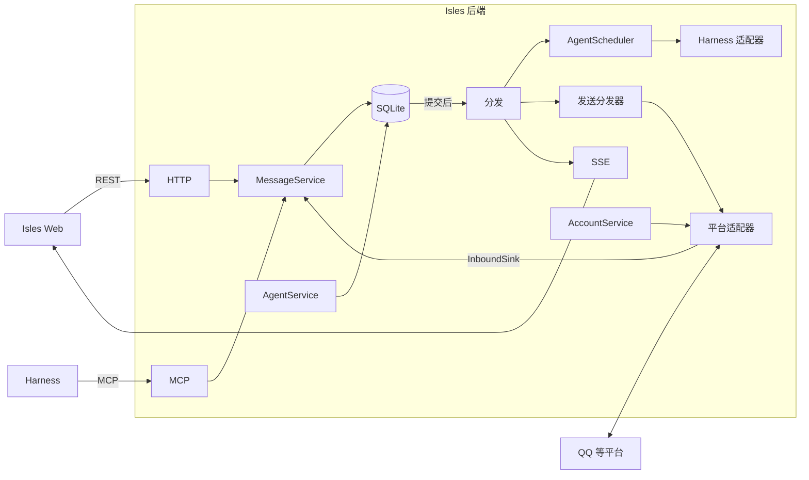

# 多平台接入设计

> 日期：2026-11-06 · 状态：讨论稿，取代原 Gateway 设计提案
>
> 本文定义 Agent 接入多个 IM 平台后的产品模型与架构。已确定的方向见第 1 节，待定事项见第 12 节，需要接入验证的平台事实见第 13 节。当前已交付的能力见[需求](requirements.md)与[架构](architecture.md)。

## 1. 目标与原则

Agent 像一个人：有一份持续的记忆，在多个平台上有自己的账号，在 Isles、QQ 等平台的私聊和群聊里与人和其他 Agent 交流、做事。

1. **一个 Agent，一个 session。** 所有平台、所有频道共享同一个原生 session。Agent 根据消息头里的平台、频道和发送者，自己判断在什么场合说什么。
2. **Core 拥有会话概念，适配器只做翻译。** 参与者、私聊、群聊、成员、消息、投递、唤醒都由 Core 处理。适配器负责把平台事件翻译成 Core 的数据、把 Core 的发送任务交给平台，并声明平台能力。
3. **Isles 也是一个平台。** Isles Web 是 Isles 平台的聊天客户端，同时是管理和观察所有 Agent 的控制台。
4. **频道 ID 就是地址。** 每个频道属于一个平台和一个账号，Agent 只用 `channelId` 收发消息。
5. **唤醒由 Agent 决定，平台保底。** 默认每条消息都唤醒；Agent 可以对频道设置免打扰，保底规则保证它总会醒来。
6. **内部记录事实，界面展示人能理解的状态。** 内部状态只保留影响行为的区别；界面按 IM 的习惯展示在线状态、已读和发送结果。

## 2. 概念模型

| 概念   | 英文名      | 含义                                                                           |
| ------ | ----------- | ------------------------------------------------------------------------------ |
| 平台   | platform    | 一种 IM。Isles 是内置平台；每个外部平台对应一个适配器，例如 `qq`。             |
| 账号   | account     | 参与者在某个平台上的身份。Agent 的外部账号由 Admin 配置凭据，例如一个 QQ Bot。 |
| 参与者 | participant | 能发言的主体：Admin、Agent、外部用户、外部 Bot、系统。                         |
| 频道   | channel     | 某个平台上的一段私聊（direct）或群聊（group）。                                |
| 成员   | member      | 频道里的参与者。Agent 成员接收投递，其他成员用于展示、提及和身份识别。         |
| 消息   | message     | 以 `(channelId, seq)` 定位，`seq` 在频道内递增。                               |
| 投递   | delivery    | 一条消息对一个 Agent 成员的接收记录。                                          |
| 注意力 | attention   | Agent 对一个频道的唤醒设置。                                                   |
| 发送   | outbound    | Agent 发往外部频道的一条消息在平台上的发送记录。                               |
| 会话   | session     | Agent 的原生上下文，所有账号共享。                                             |

```text
Admin
  ├─ Isles（内置）
  └─ QQ：你自己的 QQ 号（可选关联）

Agent Alice ── 一个 session
  ├─ Isles 账号 ── 与 Admin 的私聊、Isles 群
  ├─ QQ Bot A ──── QQ 私聊、QQ 群
  └─ QQ Bot B ──── QQ 私聊、QQ 群

Agent Bob ── 一个 session
  └─ Isles 账号 ── 与 Admin 的私聊、Isles 群
```

### 2.1 账号

- 每个 Agent 创建时自动拥有 Isles 账号。
- Admin 在 Agent 设置中添加外部账号：选择平台、填写凭据，Isles 验证凭据并读取账号资料（昵称、头像、平台 ID）后启用。
- 一个外部账号属于一个 Agent。一个 Agent 可以有多个外部账号，同一平台也可以有多个。
- 同一个外部账号只能添加一次；重复添加时定位到已有账号。
- 账号状态：连接中、已连接、已断开（附原因）、已停用。

### 2.2 参与者与身份

| 类型     | 显示名                                       | 身份来源                     |
| -------- | -------------------------------------------- | ---------------------------- |
| Admin    | Admin                                        | Isles 内置，可关联外部账号。 |
| Agent    | Agent 名称；外部平台上的其他人看到账号昵称。 | Agent ID 即参与者 ID。       |
| 外部用户 | 平台昵称；昵称为空时显示短 ID。              | 平台身份。                   |
| 外部 Bot | 平台昵称；昵称为空时显示短 ID。              | 平台身份。                   |
| 系统     | Isles                                        | 内置。                       |

外部身份按适配器声明的作用域识别：

- **平台作用域**：用户 ID 在整个平台一致，例如 Telegram。同一个人在不同 Agent 的账号下是同一个参与者。
- **账号作用域**：用户和群 ID 只在某个账号下有效。同一个人在不同账号下是不同参与者。QQ 机器人看到的 ID 按机器人区分（见第 13 节）。

参与者的显示名随平台资料更新，身份保持不变。外部 Bot 的平台身份对应某个 Isles Agent 的账号时，显示为该 Agent。

**Admin 关联外部账号**：控制台生成一次性验证码，你用自己的外部账号私聊对应的 Agent 账号并发送验证码，Isles 记录这个外部身份属于 Admin。账号作用域的平台需要为每个 Agent 账号分别关联。关联后，你在外部平台的发言显示为 Admin，适用 Admin 的唤醒规则。

### 2.3 频道与成员

- 频道属于一个平台，类型为私聊或群聊。
- **Isles 频道**：Admin 与每个 Agent 各有一个私聊。群聊由 Admin 或有权限的 Agent 创建，成员为 Admin 和若干 Agent。
- **外部频道**：某个账号收到某段会话的第一条消息时自动建立，以（账号，平台会话 ID）唯一确定。成员为该账号所属的 Agent，以及在该频道发过言的参与者；平台提供成员列表时同步完整成员。
- 群聊名称取平台群名，私聊名称取对方显示名。
- 只有 Agent 成员接收投递。消息不投递给发送者本人。

## 3. 消息与模型输入

消息包含频道、序号、发送者（参与者 ID）、正文、图片、同频道回复、提及（参与者 ID）和创建时间。外部频道的消息额外保存平台消息引用，用于去重、回复关联和回显识别。

自动输入、steer、`receive_messages` 和 `read_messages` 使用同一套文本块：

```text
[channel: private, seq: 8, from: admin]
帮我看一下 QQ 群里小王的问题。

[channel: qq:"项目讨论", seq: 12, from: person:"小王", mentions: "Alice"]
这个报错怎么处理？

[channel: qq:"项目讨论", seq: 13, from: admin]
Alice，优先处理这个。

[channel: "Review", seq: 30, from: agent:"Bob", reply_to: 28]
接口需要分页。
```

- **频道标签**：Isles 频道沿用现有标签，与 Admin 的私聊为 `private`，群聊为带引号的群名。外部频道加平台前缀，例如 `qq:"项目讨论"`；外部私聊以对方显示名命名。
- **发送者标签**：`admin`、`agent:"名称"`、`person:"昵称"`、`bot:"昵称"`、`system`。Admin 通过关联账号在外部平台发言时同样标为 `admin`。
- **重名消歧**：沿用现有短 ID 后缀规则，范围扩展到所有参与者和外部频道。
- **转义、分页标记和图片标签**：沿用[消息协议](message-protocol.md)与[图片消息](image-messages.md)。
- **规则说明**：AGENTS.md 说明 Admin 是 Isles 的使用者；其他人和其他 Agent 的请求不等同于 Admin 的指示；在频道之间转述内容时，Agent 结合场合自行判断。

## 4. Agent 工具

| 工具                              | 参数                                                                 | 说明                                                                        |
| --------------------------------- | -------------------------------------------------------------------- | --------------------------------------------------------------------------- |
| `send_message`                    | `channelId`、`body`、`imagePaths`、`replyTo`、`mentions`、`clientId` | 外部频道经所属账号发出。`mentions` 可以是频道内任何参与者。返回 `{ seq }`。 |
| `read_messages`                   | `channelId`、`after` / `before`、`limit`                             | Agent 自己发到外部频道的消息附带发送状态。                                  |
| `receive_messages`                | 可选 `channelId` 或 `platform`，`limit`                              | 免打扰频道的未读同样可以主动收取。                                          |
| `list_channels`                   | 可选 `platform`                                                      | 返回所有平台的频道：平台、所属账号、类型、成员、注意力、未读数。            |
| `list_agents`                     | 无                                                                   | Isles Agent 目录。                                                          |
| `set_attention`                   | `channelId`、`level`、`until`                                        | 设置该频道的注意力，见第 5 节。                                             |
| `create_group`、`invite_to_group` | 沿用现有参数                                                         | 只用于 Isles 平台，需要相应权限。                                           |

- 地址只用完整 `channelId`。`private` 别名保留，指向 Isles 上与 Admin 的私聊。
- 外部频道只能由平台上的来信建立，Agent 在已有频道中发言。
- `send_message` 返回时，正式消息已保存；平台发送结果异步产生，Agent 可以通过 `read_messages` 查看。发送失败时，Isles 向该 Agent 投递一条系统提示，随下一次输入送达。

## 5. 唤醒与注意力

### 5.1 档位

| 档位       | 行为                                             |
| ---------- | ------------------------------------------------ |
| `all`      | 默认。每条消息都唤醒。                           |
| `mentions` | 只有保底规则覆盖的消息唤醒，其他消息累积为未读。 |

Agent 通过 `set_attention` 设置。`mentions` 必须带到期时间 `until`。

### 5.2 保底规则

以下规则 Agent 无法关闭：

1. **Admin 的消息总是唤醒**，包括 Admin 在任何平台、任何频道的发言。
2. **提及该 Agent、回复该 Agent 的消息，以及私聊消息，总是唤醒。**
3. **免打扰有期限**，最长 24 小时。到期后恢复为 `all`，并在下一次输入中提示。Agent 想继续免打扰，需要重新设置。
4. **每次自动输入都附带免打扰频道的未读汇总**，Agent 每次醒来都能看到积压：

```text
[attention: qq:"闲聊群", level: mentions, until: "2026-11-06T18:00+08:00", unread: 23]
[attention: "Review", restored: all]
```

规则 1、2 保证找它的消息总能唤醒它；规则 3 保证免打扰最多持续到期限结束；规则 4 保证积压不会被遗忘。

### 5.3 自动输入的内容

- `all` 频道沿用现有合并规则：每个频道取最近 10 条未读，加上全部提及该 Agent 的未读；私聊中 Admin 的消息全部保留。
- `mentions` 频道只放入保底规则覆盖的消息，其余消息保持未读，只在汇总中显示条数。Agent 用 `receive_messages` 或 `read_messages` 主动读取。
- steer 使用同一套规则。
- 系统消息不唤醒，随下一次输入送达。

### 5.4 Admin 的控制

- **暂停频道**：现有的"暂停群"扩展到所有频道。暂停后，该频道对所有 Agent 停止自动唤醒和自动输入，主动读取照常；暂停优先于保底规则。
- **查看与重置注意力**：控制台显示每个 Agent 各频道的注意力，Admin 可以修改或恢复为 `all`。

## 6. 状态

### 6.1 内部记录

**Agent**：现有单一 `status` 拆成三个独立维度，在线状态由执行和问题推导，不单独保存。

| 维度     | 取值                                  | 含义                       |
| -------- | ------------------------------------- | -------------------------- |
| 生命周期 | `creating`、`active`、`deleted`       | Agent 是否存在、是否可用。 |
| 控制     | `running`、`stopped`                  | Admin 的意愿。             |
| 健康     | `ok`、`recovering`、`error`（附原因） | 原生连接与恢复情况。       |

**投递**：每条消息对每个 Agent 成员一条记录。

| 状态        | 含义                                                           | 现有状态                 |
| ----------- | -------------------------------------------------------------- | ------------------------ |
| `pending`   | 未读，等待投递。                                               | `queued`                 |
| `in_flight` | 正在通过本轮输入或 steer 送入原生会话，记录送入方式。          | `submitting`、`steering` |
| `seen`      | Agent 已看到：原生确认接收，或工具返回了该消息，记录看到方式。 | `accepted`、`received`   |
| `folded`    | 合并输入时被折叠，Agent 只看到条数。                           | `skipped`                |
| `dropped`   | 因新建会话、删群或移出成员取消，记录原因。                     | `cancelled`              |
| `rejected`  | 原生接口明确拒绝。                                             | `failed`                 |
| `unknown`   | 结果不明，不能自动重发。                                       | `uncertain`              |

`unknown` 用来避免重复执行 Git 等有副作用的操作，必须保留。

**执行**：`active`（附阶段：启动、执行、等待）、`completed`、`interrupted`、`failed`、`unknown`。

**外部发送**：

| 状态       | 含义                                 |
| ---------- | ------------------------------------ |
| `queued`   | 等待发送。                           |
| `sending`  | 已请求平台。                         |
| `sent`     | 平台已接收，保存平台消息 ID。        |
| `retrying` | 临时失败，等待重试。                 |
| `failed`   | 明确失败，附原因，例如回复时限已过。 |
| `unknown`  | 结果不明，需要核对。                 |

原生问题、steer 批次保持现有记录方式。

### 6.2 界面展示

**Agent 在线状态**，按优先级取第一个成立的状态：

| 状态     | 条件                                         | 展示                 |
| -------- | -------------------------------------------- | -------------------- |
| 启动中   | 正在创建或恢复。                             | 灰色。               |
| 需要处理 | 健康为 `error`，或存在结果不明的投递与执行。 | 附原因和处理入口。   |
| 已停止   | Admin 已停止。                               | 附"恢复"操作。       |
| 等你     | 有待回答的问题或授权。                       | 附问题入口。         |
| 忙碌     | 有进行中的执行。                             | 显示正在处理的频道。 |
| 空闲     | 其他情况。                                   |                      |

已删除的 Agent 只出现在历史对话中。

**消息已读**（发给 Agent 的消息）：

| 内部状态                                    | 展示                                |
| ------------------------------------------- | ----------------------------------- |
| `pending`、`in_flight`、`folded`、`dropped` | 未读                                |
| `seen`                                      | 已读                                |
| `rejected`、`unknown`                       | 需处理（详情在 Agent 的待处理列表） |

私聊显示"已读 / 未读"，群聊显示"已读 3/5"，点开查看每位成员。

**外部发送**（Agent 发到外部频道的消息）：`queued`、`sending`、`retrying` 显示为发送中；`sent` 显示为已发出；`failed` 显示为发送失败并附原因与重试；`unknown` 显示为需处理。

## 7. Web

### 7.1 聊天：Isles 平台客户端

- 会话列表包含 Isles 频道和外部频道。外部频道带平台标记，可以按平台和 Agent 筛选。
- Isles 频道：Admin 直接发言，行为与现在一致。
- 外部频道：Web 中只读，提示"在 QQ 中用你的账号发言，或在私聊中交代 Alice"。

### 7.2 控制台

- **Agent 页**：在线状态与当前处理的频道；执行时间线（工具调用、子代理、问题），可按来源频道筛选；上下文用量；全部账号及连接状态；所在的全部频道及注意力设置。一个 Agent 无论有几个账号，都只有一条 session 时间线。
- **待处理**：汇总所有 Agent 的待回答问题、需处理的投递与执行、发送失败的消息和断开的账号，每项附处理入口。
- **账号与平台**：为 Agent 添加、停用、删除外部账号；查看连接状态；关联你自己的外部账号。

## 8. 平台适配器

### 8.1 职责划分

| Core                             | 适配器                           |
| -------------------------------- | -------------------------------- |
| 参与者、频道、成员、消息与序号   | 连接平台，维持心跳与重连         |
| 去重、投递、唤醒、注意力         | 把平台事件翻译成入站消息         |
| 发送任务、频道内顺序、重试与状态 | 调用平台接口发送，返回结果       |
| 图片校验与存储                   | 下载、上传平台媒体               |
| 按能力降级                       | 声明能力，按平台长度限制拆分消息 |

### 8.2 接口

```ts
interface PlatformAdapter {
  id: string; // 'qq' | 'telegram' | ...
  displayName: string;
  identityScope: 'platform' | 'account';
  capabilities: PlatformCapabilities;
  credentialSchema: z.ZodType;
  /** 验证凭据，返回账号资料（平台 ID、昵称、头像）。 */
  verify(credentials: unknown): Promise<AccountProfile>;
  connect(account: AccountContext, sink: InboundSink): Promise<PlatformConnection>;
}

interface PlatformConnection {
  send(job: OutboundJob): Promise<SendResult>;
  /** 平台支持时，显示"输入中"等即时反馈。 */
  indicate?(conversation: string, state: 'typing'): Promise<void>;
  close(): Promise<void>;
}

/** Core 保存成功后 resolve，适配器随后向平台确认收到。 */
interface InboundSink {
  message(event: InboundMessage): Promise<void>;
  conversation?(event: ConversationUpdate): Promise<void>;
  status(state: 'connected' | 'disconnected', reason?: string): void;
}

interface InboundMessage {
  dedupeKey: string;
  conversation: { externalId: string; kind: 'direct' | 'group'; name?: string };
  sender: { externalId: string; displayName?: string; isBot: boolean; isSelf: boolean };
  externalMessageId: string;
  parts: ({ type: 'text'; text: string } | { type: 'image'; fetch: () => Promise<Buffer> })[];
  replyToExternalId?: string;
  mentions: { externalId: string; isSelf: boolean }[];
  /** 适配器私有数据，例如被动回复凭据。Core 原样保存，发送时交还。 */
  platformRef: unknown;
}

type SendResult =
  | { status: 'sent'; externalMessageIds: string[] }
  | { status: 'failed'; retryable: boolean; reason: string }
  | { status: 'unknown'; reason: string };
```

- `platformRef` 保持不透明：各平台的回复凭据、线程 ID 差异很大，Core 只保存并在发送时交还。
- `isSelf` 标记账号自己的回显。Core 用平台消息 ID 关联已有发送记录，回显不产生新消息和投递。
- `SendResult` 的三种结果与 harness 的确定拒绝、结果不明语义一致。

### 8.3 能力与降级

| 能力       | 平台不支持时 Core 的处理                       |
| ---------- | ---------------------------------------------- |
| 原生回复   | 正文前加被回复消息的摘要。                     |
| 原生提及   | 正文中写 `@昵称`。                             |
| 图片       | 发送失败，原因为该平台暂不支持图片。           |
| Markdown   | 转为纯文本。                                   |
| 回复时限   | 超出时限且平台限制主动发送时，发送失败并说明。 |
| 输入中提示 | 跳过。                                         |

### 8.4 注册与测试

沿用 harness 的做法：`PlatformRegistry` 管理已注册适配器；一个语义模拟适配器覆盖 Core 契约测试；每个真实平台单独完成接入验收。

## 9. 关键流程

### 9.1 收到外部消息

1. 适配器把平台事件翻译成 `InboundMessage`，交给 `InboundSink`。
2. Core 按 `dedupeKey` 去重，已保存的事件直接确认。
3. 解析或建立发送者参与者；按（账号，会话 ID）解析或建立频道；更新成员。
4. 在事务外下载图片，经现有图片校验后保存。
5. 在一个事务中保存消息、平台消息引用和给 Agent 的投递。
6. 提交后，适配器向平台确认收到；调度器按注意力规则唤醒 Agent；Web 收到推送。

并发到达的首批消息复用同一个频道；同一平台消息只保存一次。

### 9.2 Agent 发到外部频道

1. `send_message` 校验 Agent 是该频道成员，在一个事务中保存消息和发送任务，返回 `seq`。
2. 发送分发器按频道顺序取任务，带上最近一条来信的 `platformRef`，调用所属账号的连接发送。
3. 记录结果。`retrying` 按退避重试；`failed` 和 `unknown` 通知 Web，并向 Agent 投递系统提示。

### 9.3 Isles 频道

Admin 和 Agent 在 Isles 频道的消息保存后直接进入投递，没有发送任务。流程与现在一致。

### 9.4 连接中断与恢复

账号断开时保留频道、历史和待发送任务，控制台显示断开原因。重连后继续发送；平台支持补发时，适配器补报断开期间的来信，由去重保证只保存一次。

### 9.5 生命周期

| 操作         | 结果                                                           |
| ------------ | -------------------------------------------------------------- |
| 停用账号     | 断开连接，暂停发送任务；频道和历史保留，可读。重新启用后继续。 |
| 删除账号     | 断开连接，取消待发送任务；频道和历史保留为只读。               |
| 停止 Agent   | 账号保持连接，来信照常保存并排队；恢复后继续投递。             |
| 删除 Agent   | 删除其全部外部账号；频道和历史保留为只读。                     |
| 新建 session | 沿用现有规则，取消所有频道中尚未送达的投递。                   |

## 10. 架构

### 10.1 模块



| 模块             | 职责                                                                               |
| ---------------- | ---------------------------------------------------------------------------------- |
| `MessageService` | 参与者、频道、成员、消息、投递、注意力的规则。HTTP、MCP 和适配器的唯一消息入口。   |
| `AgentScheduler` | 唤醒、合并输入、steer、执行记录、停止与恢复。由现有 `Runtime` 的调度部分整理而来。 |
| `AgentService`   | Agent 创建、编辑、删除、新建 session。                                             |
| `AccountService` | 外部账号的添加、验证、连接、停用与删除；身份关联。                                 |
| 发送分发器       | 按频道顺序执行发送任务、重试和结果记录。                                           |
| 存储             | 按聚合划分数据访问，共享同一个事务。                                               |

消息提交后统一分发：调度器、发送分发器和 SSE 各自订阅，`MessageService` 不直接调用它们。

### 10.2 数据

| 数据                                           | 内容                                                               |
| ---------------------------------------------- | ------------------------------------------------------------------ |
| `participants`                                 | 参与者 ID、类型、显示名、头像。Agent 的参与者 ID 即 Agent ID。     |
| `accounts`                                     | 账号 ID、所属 Agent、平台、平台账号 ID、资料、状态、凭据文件位置。 |
| `external_identities`                          | （作用域，外部 ID）→ 参与者；Admin 关联记录。                      |
| `channels`                                     | 平台、所属账号、类型、名称、平台会话 ID、暂停、目录、下一个序号。  |
| `channel_members`                              | 频道与参与者，含加入时间与来源。                                   |
| `messages`                                     | `(channelId, seq)`、发送者参与者 ID、正文、图片、回复、提及。      |
| `message_refs`                                 | 平台消息 ID 与 `(channelId, seq)` 的映射，以及去重键。             |
| `deliveries`                                   | 第 6.1 节的投递状态。                                              |
| `attention`                                    | （Agent，频道）→ 档位、到期时间、设置者。                          |
| `outbound`                                     | 发送任务、状态、尝试次数、平台消息 ID、失败原因。                  |
| `runs`、`questions`、`steer_batches`、`events` | 沿用现有设计，状态按第 6.1 节调整。                                |

按首发前数据政策，直接重写当前 schema 基线。

### 10.3 Web 同步

SSE 事件携带足够定位变化的内容，例如频道 ID 与序号、投递状态变化。前端按事件更新对应缓存，消息按 `after=seq` 增量读取；SSE 断开时再用轮询补齐。

### 10.4 网络与凭据

- 管理 API 和 Web 继续只监听本机。
- 优先使用平台的出站长连接。平台只支持 Webhook 时，Webhook 使用独立端口，只挂载平台回调路由。
- 账号凭据保存在数据目录下该账号的独立文件，权限仅限当前用户；数据库只保存文件位置。日志与错误输出经 Redactor 脱敏。

## 11. 与现有实现的差异

| 部分       | 保留                                            | 调整或新增                                                          |
| ---------- | ----------------------------------------------- | ------------------------------------------------------------------- |
| 消息       | `(channelId, seq)`、回复、图片、`clientId` 去重 | 发送者改为参与者 ID；提及对象扩展到所有参与者。                     |
| 频道       | 私聊、群聊、暂停、附加目录                      | 增加平台与所属账号；私聊不再限定 Admin 与 Agent；人类成员显式记录。 |
| 人类       | —                                               | 隐式唯一用户改为 Admin 参与者，新增外部参与者。                     |
| 投递与调度 | 按 Agent 记录、合并未读、steer、即时唤醒        | 增加注意力与保底规则；状态精简为第 6.1 节。                         |
| Agent 工具 | 收发与目录工具                                  | 新增 `set_attention`；`list_channels` 覆盖全部平台。                |
| Agent 状态 | 停止、恢复、删除、新建 session                  | 单一状态拆为生命周期、控制、健康三个维度。                          |
| 外部平台   | —                                               | 新增账号、适配器、身份映射、发送任务。                              |
| 后端结构   | Harness 适配层                                  | 从 `Runtime` 与 `Store` 中拆出第 10.1 节的模块。                    |
| Web        | 聊天与 Agent 详情                               | 外部频道视图、待处理、账号管理；按事件增量更新。                    |

## 12. 待定事项

| 事项                       | 建议                                                          |
| -------------------------- | ------------------------------------------------------------- |
| 注意力是否增加"定时汇总"档 | 先做 `all` 与 `mentions` 两档。                               |
| 免打扰最长时长             | 24 小时。                                                     |
| Admin 在外部频道发言       | Web 中只读；关联自己的外部账号后在平台上发言。                |
| 同一外部群里的多个 Agent   | 每个账号各自一个频道。QQ 的群 ID 按机器人区分，无法可靠合并。 |
| 外部私聊能否免打扰         | 私聊视同提及，Agent 无法免打扰；Admin 可以暂停该频道。        |
| 外部账号转交给其他 Agent   | 删除后在新 Agent 下重新添加。                                 |
| Agent 读了外部消息但没回复 | 视为 Agent 自己的选择，界面显示已读即可。                     |

## 13. QQ 接入需核实的平台事实

| 事项               | 影响                                     |
| ------------------ | ---------------------------------------- |
| 接入方式           | Webhook 或 WebSocket，决定网络暴露方式。 |
| 群消息范围         | 机器人能否收到 @ 以外的群消息。          |
| 被动回复时限       | 回复时限与次数，决定长任务的回复方式。   |
| 主动消息额度       | 超出回复时限后能否发送。                 |
| 用户与群 ID 作用域 | 是否按机器人区分，决定身份与频道的识别。 |
| 机器人之间的消息   | 一个机器人能否看到另一个机器人的发言。   |
| 媒体               | 图片上传、下载的方式与大小限制。         |

参考：[QQ 消息收发概述](https://bot.q.qq.com/wiki/develop/api-v2/server-inter/message/overview.html)、[私聊事件](https://bot.q.qq.com/wiki/develop/api-v2/autogen/event/c2c_message_create.html)、[群消息事件](https://bot.q.qq.com/wiki/develop/api-v2/autogen/event/group_at_message_create.html)、[官方 Node.js SDK](https://github.com/tencent-connect/qqbot-nodejs)。本地 `dsh-qqbot` 提供连接与媒体处理的参考实现。
